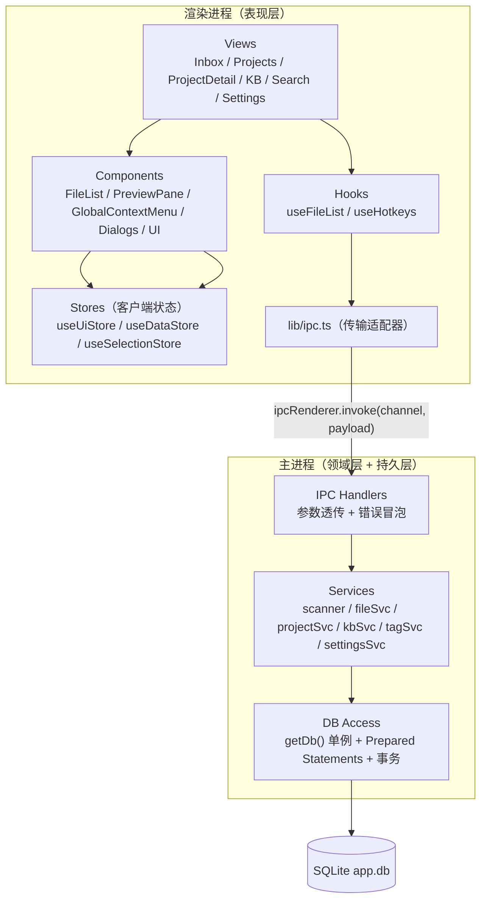
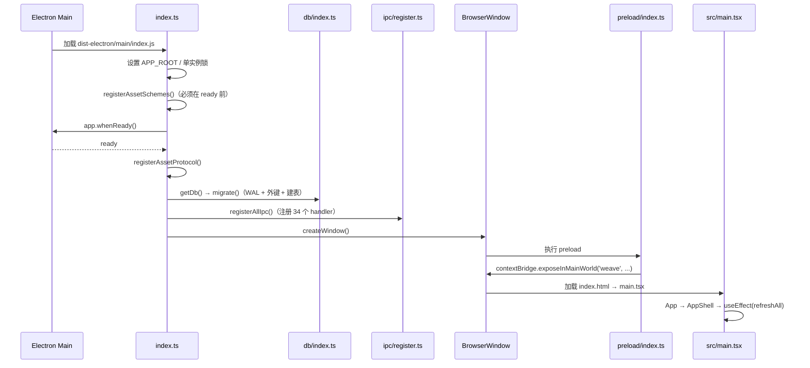
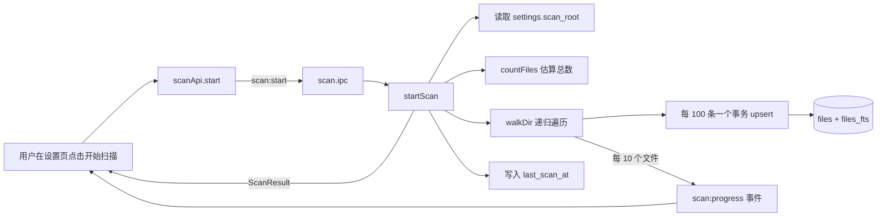

# 01 · 整体架构

## 1. 进程与边界

应用采用标准 Electron 三层结构，并启用 `contextIsolation: true`、`nodeIntegration: false`：

| 层 | 目录 | 运行时 | 职责 |
| --- | --- | --- | --- |
| 主进程 | `electron/main/` | Node.js（Electron Main） | 窗口生命周期、文件系统扫描、SQLite 读写、系统 Shell、自动更新、自定义协议 |
| 预加载 | `electron/preload/` | 隔离上下文 | 通过 `contextBridge` 暴露白名单 API `window.weave`，不暴露 `ipcRenderer` |
| 渲染进程 | `src/` | Chromium Renderer | React 视图、交互状态、展示与格式化；不直接访问 Node/DB |

主进程创建窗口的关键配置位于 [electron/main/index.ts](../../electron/main/index.ts#L49-L62)：

```ts
webPreferences: {
  preload,
  contextIsolation: true,
  nodeIntegration: false,
}
```

预加载只暴露业务 API，入口见 [electron/preload/index.ts](../../electron/preload/index.ts#L8-L85)。渲染端禁止直接调用 `window.weave`，统一经 [src/lib/ipc.ts](../../src/lib/ipc.ts) 包装。

## 2. 内部分层



分层规则（代码实际遵循）：

1. **视图不写 SQL**：视图通过 `fileApi/projectApi/kbApi/tagApi/settingsApi/scanApi` 调用主进程。
2. **IPC Handler 不做业务**：`ipc/*.ipc.ts` 只解包参数、调用 Service、返回值（如 [file.ipc.ts](../../electron/main/ipc/file.ipc.ts)）。
3. **Service 不碰窗口**：Service 只依赖 `getDb()`、`node:fs`、`electron.shell`、`electron.dialog`、`app`。唯一例外是扫描进度由 IPC 层通过回调转发（[scan.ipc.ts](../../electron/main/ipc/scan.ipc.ts#L13-L19)）。
4. **共享契约独立**：`src/shared/` 同时被主进程、预加载、渲染进程引用（Vite 别名 `@shared`）。

## 3. 启动时序



要点：

- `registerAssetSchemes()` 在模块顶层执行（[index.ts L83](../../electron/main/index.ts#L83)），因为 Electron 要求特权 scheme 在 `ready` 之前注册；`registerAssetProtocol()` 必须在 `ready` 之后（[index.ts L85-L93](../../electron/main/index.ts#L85-L93)）。仓库提交 `1960a2a` 记录的正是这个修复。
- 单实例：`requestSingleInstanceLock()`，第二实例会聚焦已有窗口（[index.ts L40-L43](../../electron/main/index.ts#L40-L43), [L101-L106](../../electron/main/index.ts#L101-L106)）。
- 退出：`window-all-closed` 中 `closeDb()`，非 macOS 直接退出（[index.ts L95-L99](../../electron/main/index.ts#L95-L99)）。
- 开发模式自动打开 DevTools，生产加载 `dist/index.html`（[index.ts L64-L70](../../electron/main/index.ts#L64-L70)）。

## 4. 关键数据流

### 4.1 扫描入库



- 扫描逻辑：[scanner.ts](../../electron/main/services/scanner.ts)。
- 状态判定：`stats.mtimeMs > last_scan_at` → `inbox`，否则 `filed`（[scanner.ts L121-L124](../../electron/main/services/scanner.ts#L121-L124)）。
- 写入使用 `INSERT ... ON CONFLICT(path) DO UPDATE SET size, mtime`（[scanner.ts L64-L70](../../electron/main/services/scanner.ts#L64-L70)），已存在记录不会重置状态。
- 拼音首字母在插入时计算并写入 `files.pinyin`，供 FTS 检索（[pinyin.ts](../../electron/main/util/pinyin.ts)）。

### 4.2 文件列表读取

所有列表（收件箱/项目/知识库/搜索）统一走 `fileSvc.listFiles(source, sort)`，差异只体现在 `source.kind` 生成的 SQL 片段（[fileSvc.ts L12-L69](../../electron/main/services/fileSvc.ts#L12-L69)）。返回前统一补全 `tags` 与 `pathMissing`（`fs.existsSync`，[L151-L162](../../electron/main/services/fileSvc.ts#L151-L162)）。

### 4.3 搜索


权重：文件名前缀 `1`、拼音前缀 `1.5`、文件名包含 `2`、拼音包含 `2.5`、仅 FTS 命中 `3`、别名包含 `4`、标签命中 `5`（[fileSvc.ts L88-L146](../../electron/main/services/fileSvc.ts#L88-L146)）。

### 4.4 知识库 / 项目 / 标签

均为“关联表 + 标记字段”的虚拟归类，不移动磁盘文件：

- 存入知识库：`files.in_knowledge = 1`，可选写 `resource_topic_links`，可选把 `status` 改为 `filed`。
- 移出知识库：`in_knowledge = 0`，删除全部专题关联，可选放回收件箱。
- 项目：`project_files` 关联；加入项目时把 `status` 改为 `filed`。
- 标签：`tag_links` 关联，追加语义（`INSERT OR IGNORE`）。

### 4.5 预览

当前版本为“元数据预览”：`PreviewPane` 调 `fileApi.previewMeta(id)` 取 `FileRow`，交给 [UnsupportedPreview](../../src/components/previews/UnsupportedPreview.tsx) 展示类型/大小/时间/路径，并提供“打开/定位”按钮。`weave-asset://` 协议已经可用，但渲染端尚未使用它加载真实内容。

> 行为注意：`PreviewPane` 的预览对象取自 `useUiStore.contextMenu?.fileIds[0]`（[PreviewPane.tsx L22-L24](../../src/components/layout/PreviewPane.tsx#L22-L24)），即“右键选中项”，而不是当前列表选中项。单击行只会打开预览面板，不会切换预览文件。详见 [09-conventions-and-gaps.md](09-conventions-and-gaps.md)。

## 5. 关键设计决策

| 决策 | 实现 | 理由/影响 |
| --- | --- | --- |
| SQLite 作为唯一事实来源 | `getDb()` 单例，所有业务表在 [schema.ts](../../electron/main/db/schema.ts) | 避免前端内存状态与磁盘不一致；刷新即重新查询 |
| 虚拟归类而非物理移动 | `status`、`in_knowledge`、关联表 | 满足“绝不修改文件内容/位置”的约束，删除关联不影响磁盘 |
| FTS5 external content + 触发器 | `files_fts` 与 3 个触发器 | 索引随 `files` 自动同步，避免手工维护 |
| 拼音首字母搜索 | `pinyin-pro` + `files.pinyin` | 支持中文文件名首字母检索 |
| 自定义协议而非 `file://` | `weave-asset://file/<id>` | 以文件 ID 而非真实路径访问，限制大小与 MIME |
| 类型化 IPC 契约 | `CH` 常量 + `WeaveAPI` 声明 | 三端共享，降低通道名/参数漂移 |
| 虚拟滚动 | `@tanstack/react-virtual`，行高 36 | 面向十万级文件列表 |
| 按列表实例隔离选择 | `useSelectionStore.byKey` | 同一文件可同时出现在搜索/项目/KB，选择互不干扰 |
| 视图状态与数据状态分离 | `useUiStore` vs `useDataStore` | UI 切换不触发全量数据刷新，职责清晰 |
| Service 内事务批处理 | `db.transaction(...)` | 扫描与批量关联保证一致性、提升吞吐 |

## 6. 约束与非目标（当前代码）

- 不修改文件内容、不重命名、不移动：主进程对文件仅有 `stat`、`readFile`（资源协议）、`shell.openPath`、`shell.showItemInFolder`。
- 不依赖云服务：数据库在本地，未发现网络请求代码。
- AI 能力未接入：`package.json` 无 Ollama/HTTP 客户端依赖，README 中的 AI 步骤仍在路线图中。
- 渲染进程不启用 Node：`nodeIntegration: false`；`vite.config.ts` 中 `renderer: {}` 适配器被注释。
- 自动更新只对打包产物生效：`check-update` 在 `!app.isPackaged` 时直接返回错误（[update.ts L33-L45](../../electron/main/update.ts#L33-L45)）。

## 7. 与外部系统的边界

| 外部系统 | 交互方式 | 代码 |
| --- | --- | --- |
| 文件系统 | `node:fs` 递归遍历/读取/存在性检查 | `scanner.ts`、`fileSvc.ts`、`assetProtocol.ts` |
| 系统默认程序 | `shell.openPath` | `fileSvc.openFile` |
| 文件管理器 | `shell.showItemInFolder` | `fileSvc.revealFile` |
| 目录选择器 | `dialog.showOpenDialogSync` | `settingsSvc.pickRoot` |
| 自动更新服务 | `electron-updater`（GitHub provider） | `update.ts`、`electron-builder.json` |
| SQLite | `better-sqlite3`（同步 API） | `db/index.ts`、各 Service |
