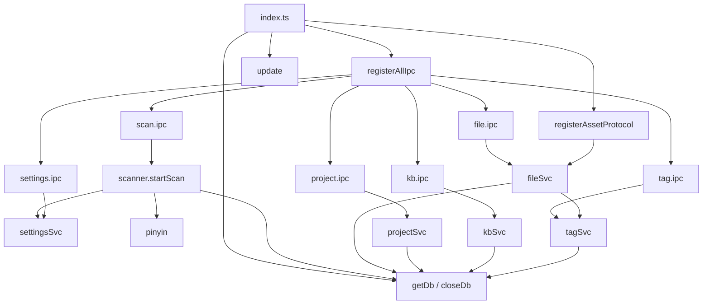

# 03 · 主进程详解

主进程是应用的“后端”：负责窗口、磁盘扫描、SQLite 持久化、系统集成与更新。所有源码位于 `electron/main/`，入口为 [electron/main/index.ts](../../electron/main/index.ts)。

## 1. 入口与生命周期

### 1.1 全局常量

| 常量 | 值 | 用途 |
| --- | --- | --- |
| `APP_ROOT` | `path.join(__dirname, '../..')` | 开发/打包时的根定位 |
| `MAIN_DIST` | `<root>/dist-electron` | 主进程产物目录 |
| `RENDERER_DIST` | `<root>/dist` | 渲染产物目录 |
| `VITE_DEV_SERVER_URL` | 环境变量 | 存在即开发模式，加载 dev server |
| `VITE_PUBLIC` | dev: `<root>/public`；prod: `dist` | 图标等静态资源根 |

### 1.2 启动顺序（不可随意调整）

1. **模块顶层**：
   - Windows 7 检测：`os.release().startsWith('6.1')` → `disableHardwareAcceleration()`。
   - Windows 设置 `app.setAppUserModelId(app.getName())`（通知需要）。
   - `app.requestSingleInstanceLock()`，失败立即退出。
2. **注册特权 scheme**：`registerAssetSchemes()` 必须在 `app.whenReady()` 之前。
3. **`app.whenReady()` 回调**：
   - `registerAssetProtocol()` — 必须在 ready 之后，否则 session 未就绪会报错。
   - `getDb()` — 打开 SQLite 并执行迁移。
   - `registerAllIpc()` — 注册全部 handler。
   - `createWindow()` — 创建 1200×760（最小 800×500）窗口，标题 “Weave 工作台”。
4. **窗口行为**：
   - 开发模式 `loadURL(VITE_DEV_SERVER_URL)` 并打开 DevTools；生产 `loadFile(dist/index.html)`。
   - `setWindowOpenHandler`：仅允许 `https:` 交给系统浏览器，其余拒绝。
   - `update(win)` 接线自动更新。
5. **退出**：`window-all-closed` → `closeDb()`，非 macOS 退出。
6. **第二实例**：`second-instance` 恢复/聚焦已有窗口。
7. **macOS 激活**：无窗口时重建。

> 单例锁与 `activate` 逻辑位于 [index.ts L40-L43](../../electron/main/index.ts#L40-L43) 与 [L101-L115](../../electron/main/index.ts#L101-L115)。

## 2. 数据库层

### 2.1 路径解析

[electron/main/db-path.ts](../../electron/main/db-path.ts)：

```ts
if (!app.isPackaged) {
  // 开发：<cwd>/.localdb/app.db（目录不存在则创建）
} else {
  // 生产：app.getPath('userData')/app.db
}
```

- 开发库当前位于仓库 `.localdb/app.db`（见目录结构）。
- 打包后用户数据在系统 `userData` 目录，卸载默认不删除（`deleteAppDataOnUninstall: false`）。

### 2.2 单例与迁移

[electron/main/db/index.ts](../../electron/main/db/index.ts)：

| 函数 | 行为 |
| --- | --- |
| `getDb()` | 惰性创建 `Database` 单例，首次调用执行 `migrate(db)`；后续直接复用 |
| `closeDb()` | 关闭并置空；应用退出时调用 |

[electron/main/db/migrate.ts](../../electron/main/db/migrate.ts)：

1. `db.pragma('journal_mode = WAL')` —— 读写并发友好，必须最先设置。
2. `db.pragma('foreign_keys = ON')` —— 让 `ON DELETE CASCADE` 生效。
3. `db.exec(SCHEMA_SQL)` —— 幂等建表/索引/触发器。
4. 读取 `settings.schema_version`：
   - 不存在：写入当前 `SCHEMA_VERSION = '1'`，并 `INSERT OR IGNORE last_scan_at = '0'`。
   - 存在但不同：当前仅更新版本号（未来迁移入口，尚未实现逐版本迁移）。

> 数据库 Schema 的完整说明见 [05-data-model.md](05-data-model.md)。

## 3. Service 层

Service 全部导出纯函数，内部调用 `getDb()` 获取连接。约定：批量写操作使用 `db.transaction()` 包裹。

### 3.1 扫描服务 [scanner.ts](../../electron/main/services/scanner.ts)

模块级状态：

- `scanning: boolean` —— 防重入；`isScanning()` 供 IPC 层检查。
- `cancelled: boolean` —— `cancelScan()` 置位，遍历回调返回 `false` 中止。

`startScan(onProgress?)` 流程：

1. 若 `scanning` 为真 → 抛 `已有扫描正在进行`。
2. 读取 `settings.scan_root`；缺失 → `未设置扫描根目录`；不存在 → `根目录不存在`；无读权限 → `根目录无读取权限`。
3. 置 `scanning = true`、`cancelled = false`。
4. 读取 `last_scan_at`，`countFiles(root)` 估算总数（失败则 0）。
5. 准备 upsert：

```sql
INSERT INTO files (name, alias, path, size, ext, mtime, status, in_knowledge, pinyin, created_at)
VALUES (?, NULL, ?, ?, ?, ?, ?, 0, ?, ?)
ON CONFLICT(path) DO UPDATE SET size = excluded.size, mtime = excluded.mtime
```

6. `walkDir` 递归；每 100 条执行一次事务；每 10 个文件回调一次 `ScanProgress`。
7. 完成且未取消 → 写 `last_scan_at = Date.now()`；返回 `{ scanned, added, skipped }`（`skipped` 目前恒为 0）。
8. 异常时复位 `scanning` 并抛出。

遍历规则（`walkDir` / `countFiles`）：

- 跳过以 `.` 开头的文件/目录。
- 跳过 `$RECYCLE.BIN`、`System Volume Information`。
- 无权限目录静默跳过；`statSync` 失败的文件跳过。
- 扩展名小写且不含点；无扩展名存为 `'none'`。

状态判定（重要）：

```ts
const status = lastScanAt > 0 && stats.mtimeMs > lastScanAt ? 'inbox' : 'filed';
```

含义：**首次扫描（`last_scan_at = 0`）所有文件都会是 `filed`**；后续扫描中修改时间晚于上次扫描的新文件才是 `inbox`。已存在记录因 `ON CONFLICT` 不更新 `status`，不会重新进入收件箱。

### 3.2 文件服务 [fileSvc.ts](../../electron/main/services/fileSvc.ts)

| 函数 | 说明 |
| --- | --- |
| `listFiles(source, sort)` | 统一列表入口；按 `source.kind` 拼接 SQL；搜索走 FTS 分支；最后 `enrichFileRows` 补标签与 `pathMissing` |
| `sortColumn(sort)` | `name`/`ext` 用 `COLLATE NOCASE`，`size`/`mtime` 直接排序 |
| `buildSearchQuery(query)` | 生成 FTS5 前缀查询 + 标签 UNION 子查询与 rank 权重 |
| `getFile(id)` | 单条查询 + 标签 + 路径存在性 |
| `removeFiles(ids)` | 仅删 DB 记录（`DELETE FROM files`），级联删除关联；返回 `{ok, fail}` |
| `markFiled(ids)` | `UPDATE ... SET status='filed' WHERE id IN (...) AND status='inbox'` |
| `openFile(id)` | 校验存在/路径；`shell.openPath` 返回非空字符串即失败原因 |
| `revealFile(id)` | `shell.showItemInFolder`，路径失效返回 `false` |
| `getPreviewMeta(id)` | 目前等价于 `getFile(id)` |
| `getInboxCount()` | 统计 `status='inbox'`（当前渲染端未使用，计数在前端由列表长度得出） |
| `isFileInProject(fileId, projectId)` | 关联存在性（当前未使用） |
| `getFirstProjectForFile(fileId)` | 文件最早加入的项目（用于来源徽章，当前未使用） |

列表来源 SQL（`switch` 分支）：

| `source.kind` | 条件 |
| --- | --- |
| `inbox` | `f.status = 'inbox'` |
| `project` | `JOIN project_files pf ON pf.file_id = f.id WHERE pf.project_id = ?` |
| `kb-all` | `f.in_knowledge = 1` |
| `kb-uncategorized` | `LEFT JOIN resource_topic_links ... WHERE in_knowledge = 1 AND rtl.topic_id IS NULL` |
| `kb-topic` | `JOIN resource_topic_links ... WHERE topic_id = ?` |
| `search` | `JOIN (searchSql) s ON s.rowid = f.id`，`ORDER BY s.rank ASC, mtime DESC` |

### 3.3 项目服务 [projectSvc.ts](../../electron/main/services/projectSvc.ts)

- `listProjects(filter)`：`LEFT JOIN project_files` 聚合 `file_count`，按 `updated_at DESC`；`filter` 为 `active|done` 时加 `WHERE p.status = ?`。
- `getProject(id)`：同上，单条。
- `createProject(name)`：trim 后长度 1–50；查重名；写入 `status='active'`，返回完整 `ProjectRow`。
- `renameProject(id, name)`：长度校验 + 排除自身查重 + 更新 `updated_at`。
- `deleteProject(id)`：删除项目，`project_files` 由外键级联清理。
- `setProjectStatus(id, status)`：更新状态与 `updated_at`。
- `addFilesToProject(projectId, fileIds)`：事务内 `INSERT OR IGNORE` 关联、将 `inbox` 文件标记 `filed`、刷新项目 `updated_at`。
- `removeFileFromProject(projectId, fileId)`：事务内删关联并刷新 `updated_at`。
- `getProjectIdsForFile(fileId)`：返回所属项目 ID（当前未使用）。

### 3.4 知识库服务 [kbSvc.ts](../../electron/main/services/kbSvc.ts)

- `listTopics()`：`LEFT JOIN resource_topic_links` 聚合 `file_count`，按 `sort_order ASC, created_at ASC`。
- `createTopic(name)`：1–30 字、查重；`sort_order = MAX(sort_order)+1`（新专题排最后）。
- `renameTopic(id, name)`：1–30 字、排除自身查重。
- `deleteTopic(id)`：删除专题；文件仍 `in_knowledge=1` 但不在任何专题 → 自动落入“未分类”。
- `reorderTopics(topicIds)`：事务内按数组下标重写 `sort_order`。
- `addToKnowledge(fileIds, topicIds, moveOutOfInbox)`：事务内 `in_knowledge=1`、逐个 `INSERT OR IGNORE` 专题关联、可选标记 `filed`。
- `removeFromKnowledge(fileIds, toInbox)`：事务内 `in_knowledge=0`、删除该文件所有专题关联、可选置回 `inbox`。
- `addToTopic(fileIds, topicId)` / `removeFromTopic(fileIds, topicId)`：批量关联增删。
- `getKbCounts()`、`isFileInTopic()`、`getTopicIdsForFile()`：当前主进程存在但未被 IPC 暴露（渲染端以列表长度自行计数）。

### 3.5 标签服务 [tagSvc.ts](../../electron/main/services/tagSvc.ts)

- `listTags()`：按名称 `COLLATE NOCASE` 排序。
- `createTag(name)`：1–20 字、禁止逗号；`INSERT OR IGNORE`，若已存在返回既有标签（幂等）。
- `addToFiles(fileIds, tagIds)`：事务内双重循环 `INSERT OR IGNORE`（追加语义）。
- `removeFromFiles(fileIds, tagIds)`：事务内双重循环删除。
- `getTagsForFile(fileId)`：单文件标签（当前未使用）。
- `getTagsForFiles(fileIds)`：一次查询返回 `Map<fileId, TagRef[]>`，被 `fileSvc` 用于列表富化。

### 3.6 设置服务 [settingsSvc.ts](../../electron/main/services/settingsSvc.ts)

- 键值表读写：`getSetting` / `setSetting`（UPSERT）/ `getAllSettings`。
- `pickRoot()`：`dialog.showOpenDialogSync` 选择目录，并校验可读；取消/不可读返回 `null`。
- `getDatabasePath()`：返回 `getDbPath()`。
- `getAppVersion()`：`app.getVersion()`。

当前使用的设置键：

| key | 写入方 | 读取方 |
| --- | --- | --- |
| `scan_root` | `settings:set`（设置页） | `scanner.startScan` |
| `last_scan_at` | `scanner.startScan` | `scanner.startScan`、设置页 |
| `schema_version` | `migrate` | `migrate` |

## 4. IPC 层

### 4.1 注册总入口

[electron/main/ipc/register.ts](../../electron/main/ipc/register.ts) 依次调用：

```ts
registerScanIpc();     // scan:start / scan:cancel
registerFileIpc();     // file:* 7 个
registerProjectIpc();  // project:* 7 个
registerKbIpc();       // kb:* 9 个
registerTagIpc();      // tag:* 4 个
registerSettingsIpc(); // settings:* 5 个
```

共 34 个 `ipcMain.handle`。

### 4.2 参数与错误语义

- Handler 多数直接透传参数，不额外 try/catch；Service 抛出的 `Error` 会以 rejected Promise 形式传回渲染进程（`ipcRenderer.invoke` 抛错）。
- 扫描进度是唯一的主→渲染事件：

```ts
const win = BrowserWindow.getFocusedWindow();
const result = await startScan((progress) => {
  if (win && !win.isDestroyed()) win.webContents.send(CH.SCAN_PROGRESS, progress);
});
return result;
```

  （[scan.ipc.ts L8-L21](../../electron/main/ipc/scan.ipc.ts#L8-L21)）注意：进度发送给“当前聚焦窗口”，若扫描期间焦点在别的窗口/无焦点窗口，可能收不到进度。

- `CH.SCAN_RESULT` 常量已定义但未使用；扫描结果通过 `scan:start` 的返回值传递。

### 4.3 通道完整清单

见 [06-ipc-api.md](06-ipc-api.md)。

## 5. 自定义资源协议

[electron/main/preview/assetProtocol.ts](../../electron/main/preview/assetProtocol.ts)：

- Scheme：`weave-asset`，特权：`standard`、`secure`、`supportFetchAPI`、`bypassCSP: false`。
- URL 格式：`weave-asset://file/<id>`。
- 处理流程：
  1. 解析 URL，正则 `^/file/(\d+)` 提取 ID，不匹配 → 400。
  2. `getFile(id)` 不存在 → 404。
  3. `pathMissing` → 410。
  4. 大小 > 100MB → 413。
  5. `fs.readFile` 后返回 `Response`，`Content-Type` 由扩展名映射，`Content-Length`、`Cache-Control: no-store`。
  6. 异常 → 500 并 `console.error('[weave-asset] error:', e)`。
- MIME 映射：pdf、png、jpg/jpeg、gif、webp、bmp、docx、xlsx；其余 `application/octet-stream`。
- 安全性：只按数据库 ID 取路径，不接受任意路径；但 `FileRow.path` 本身仍通过 IPC 返回给渲染进程。

当前渲染端尚未使用该协议（`src/` 中无 `weave-asset` 引用），属于预留给后续二进制预览的基础设施。

## 6. 自动更新

[electron/main/update.ts](../../electron/main/update.ts)：

- `autoUpdater.autoDownload = false`、`allowDowngrade = false`。
- 事件 → 渲染进程：
  - `update-can-available` `{ update, version, newVersion }`
  - `download-progress` `ProgressInfo`
  - `update-error` `{ message, error }`
  - `update-downloaded`
- 渲染进程可调用：
  - `check-update`：非打包环境返回错误对象；否则 `autoUpdater.checkForUpdates()`。
  - `start-download`：`isDownloading` 防重入，绑定进度/错误/完成事件，支持 `CancellationToken`。
  - `cancel-download`：取消并重建 token。
  - `quit-and-install`：`autoUpdater.quitAndInstall(false, true)`。
- 限制：这些通道没有加入 `CH` 契约，属于早期模板 API；渲染端更新组件使用 `window.ipcRenderer`，而预加载只暴露 `window.weave`，因此该组件当前不可用且未挂载。详见 [09-conventions-and-gaps.md](09-conventions-and-gaps.md)。

## 7. 拼音工具

[electron/main/util/pinyin.ts](../../electron/main/util/pinyin.ts)：

- `getPinyinInitials(text)`：`pinyin-pro` 取首字母，`nonZh: 'consecutive'`，最终 `toLowerCase().replace(/[^a-z0-9]/g, '')`。
- `getNamePinyin(name, alias)`：优先 alias，去掉最后一个扩展名后取首字母。
- 扫描时以 `getNamePinyin(name, null)` 写入；当前没有别名写入接口，因此别名变化不会更新 `pinyin`。

## 8. 主进程函数调用关系（速查）


