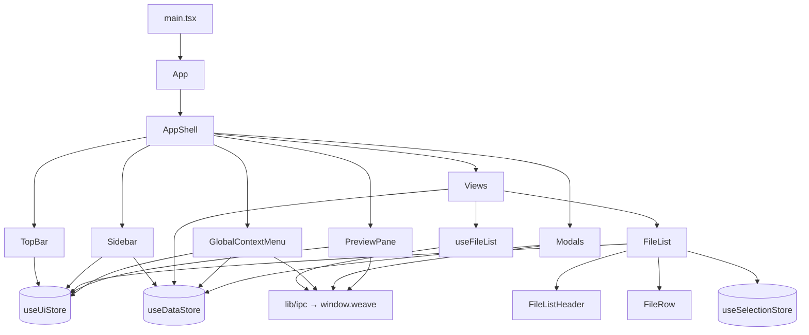

# 04 · 渲染进程详解

渲染进程是纯 React 应用：只负责展示与交互，所有持久数据通过 `window.weave` 请求主进程。入口链路：

```text
index.html → src/main.tsx → <App/> → <AppShell/> → 当前 View + 全局组件
```

## 1. 入口与启动

[src/main.tsx](../../src/main.tsx)：

- `ReactDOM.createRoot(document.getElementById('root')!)`，开启 `React.StrictMode`。
- 引入 [index.css](../../src/index.css)（Tailwind v4 + 设计令牌）。
- `postMessage({ payload: 'removeLoading' }, '*')` 通知预加载移除启动动画。
- Node 演示入口 `./demos/node` 已注释；`ipcRenderer` 未启用。

[src/App.tsx](../../src/App.tsx) 仅返回 `<AppShell/>`。

## 2. AppShell：全局装配

[AppShell.tsx](../../src/components/layout/AppShell.tsx) 是所有全局状态的“总装厂”：

```text
┌──────────────────────────────────────────────┐
│ TopBar（折叠、搜索、设置）                     │
├──────────┬───────────────────────┬───────────┤
│ Sidebar  │ main: renderView()    │ PreviewPane│
│ 收件箱   │ InboxView / ...       │ 元数据预览 │
│ 项目     │                       │           │
│ 知识库   │                       │           │
│ 设置     │                       │           │
├──────────┴───────────────────────┴───────────┤
│ GlobalContextMenu（fixed）                    │
│ Modal 路由 + Toast                            │
└──────────────────────────────────────────────┘
```

- 挂载时 `refreshAll()` 拉取收件箱数、项目、专题、知识库计数、标签（[AppShell L31-L33](../../src/components/layout/AppShell.tsx#L31-L33)）。
- `activeView` 决定主内容区，`default` 回落到 `InboxView`。
- `modal` 是一个可辨识联合，按 `type` 渲染对话框：
  `new-project`、`rename`、`save-to-kb`、`remove-from-kb`、`add-files-to-project`、`confirm`、`batch-result`。
  其中 `new-topic` 仅在类型中定义，AppShell 未渲染对应组件（专题新建在 KnowledgeBaseView 内联完成）。
- Toast 3 秒自动隐藏；`error` 用红色，其余深色。

## 3. 状态管理（Zustand）

三个 Store 职责清晰，不做持久化（刷新/重启后从数据库重建）。

### 3.1 `useUiStore`（UI 状态）

文件：[stores/useUiStore.ts](../../src/stores/useUiStore.ts)

| 字段 | 类型 | 说明 |
| --- | --- | --- |
| `activeView` | `'inbox' \| 'projects' \| 'project-detail' \| 'kb' \| 'settings' \| 'search'` | 当前视图 |
| `activeProjectId` | `number \| null` | 项目详情页上下文 |
| `kbSelected` | `{kind:'all'} \| {kind:'uncategorized'} \| {kind:'topic',id}` | 知识库当前选中项 |
| `sidebarCollapsed` | `boolean` | 侧栏宽度 220px ↔ 56px（`w-14`） |
| `previewOpen` / `previewWidth` | `boolean` / `number` | 预览面板开关与宽度（360–480） |
| `searchQuery` | `string` | 搜索词 |
| `contextMenu` | `{x,y,fileIds,scene,currentProjectId?} \| null` | 全局右键菜单状态 |
| `modal` | `ModalState` | 全局模态路由 |
| `toast` | `{message,type} \| null` | 全局提示 |

关键行为：

- `setSearchQuery(q)` 会同时切换视图：`q.trim()` 非空 → `search`，否则 `inbox`。
- `setActiveView` 会顺带清空 `contextMenu`。
- `openModal` 也会清空右键菜单。
- `setPreviewWidth` 内部 clamp 到 360–480。

### 3.2 `useDataStore`（领域计数与集合）

文件：[stores/useDataStore.ts](../../src/stores/useDataStore.ts)

| 字段/方法 | 说明 |
| --- | --- |
| `inboxCount` | `fileApi.list({kind:'inbox'})` 的长度 |
| `projects` / `projectFilter` | 项目列表；筛选变化时重新拉取 |
| `topics` | 知识库专题 |
| `kbCounts` | `{all, uncategorized}`，同样通过列表长度计算 |
| `tags` | 标签集合 |
| `loading` | `refreshAll` 期间为 true |
| `refreshAll()` | `Promise.all` 并行刷新以上五项 |

设计注意：计数不是 SQL `COUNT(*)`，而是拉取完整列表再取 `.length`（[useDataStore L33-L81](../../src/stores/useDataStore.ts#L33-L81)）。文件量大时会有额外开销，但实现简单、始终与列表一致。

### 3.3 `useSelectionStore`（多选）

文件：[stores/useSelectionStore.ts](../../src/stores/useSelectionStore.ts)

- 结构：`byKey: Record<string, { ids: Set<number>; anchor: number\|null; focus: number\|null }>`。
- `listKey` 由各视图自定义，例如 `inbox`、`project-<id>`、`kb-<kind>-<id>`、`search`、`add-files-project-<id>`。
- 操作：
  - `single`：单选，设置 anchor/focus。
  - `toggle`：Ctrl/Cmd 切换，anchor/focus 跟随。
  - `range`：Shift 范围选择，**不更新 anchor**（保持起点）。
  - `selectAll` / `clear` / `setFocus`。
- 取值方法（`getIds/isSelected/...`）是命令式读取，配合 `FileList` 的本地渲染使用；Store 本身仍可被订阅触发重渲染。

## 4. 数据加载 Hook：`useFileList`

文件：[hooks/useFileList.ts](../../src/hooks/useFileList.ts)

```ts
const { rows, loading, sort, setSortKey, toggleSortDir, refresh } =
  useFileList({ listKey, source, defaultSort, enabled });
```

- `sourceKey = JSON.stringify(source)`：源变化触发重新加载。
- `sort` 以本地 state 维护，`sort.key/dir` 变化会重建 `load` 并触发 effect。
- `enabled=false` 时不请求（如项目未选中、搜索词为空）。
- `abortRef` 是布尔标志，effect 清理时置 true。快速切换排序/源时，旧请求可能在后续请求开始后返回（`abortRef` 又被置 false），存在“旧结果覆盖新结果”的竞态风险，见 [09](09-conventions-and-gaps.md)。

> `listKey` 参数目前未在 Hook 内使用，选择隔离由调用方传给 `FileList` 的同一个 key 完成。

## 5. 列表基础设施

### 5.1 FileList

文件：[FileList.tsx](../../src/components/filelist/FileList.tsx)

职责：

- `useVirtualizer` 虚拟滚动：`estimateSize = 36`，`overscan = 10`，绝对定位 `translateY(start)`。
- 三种渲染状态：加载骨架（`SkeletonRow`）、空态（`EmptyState`）、正常列表。
- 选择交互：
  - 单击：`Ctrl/Cmd` → `toggle`；`Shift` → `range`；否则 `single`。
  - 复选框：`toggle`（阻止冒泡）。
  - 表头全选：全选/清空切换。
  - 空白区点击：清空选择。
- 右键：若目标行未选中，先单选该行，再以当前选中集合打开全局菜单。
- 双击：路径有效则 `fileApi.open`。
- 键盘（`useHotkeys`）：
  - `↑/↓`：移动 focus 并打开预览面板；
  - `Delete/Backspace`（无 Ctrl/Cmd）：打开“移出索引”确认框；
  - `Esc`：清空选择；
  - `Enter`：打开 focus/首个选中项；
  - `Ctrl/Cmd+A`：全选。
- focus 变化时 `scrollToIndex(idx, {align:'auto'})`。

Props：`listKey`、`rows`、`loading`、`sort`、`onSortChange`、`showSourceBadge`、`scene`、`currentProjectId`、`onRefresh`、`emptyText`、`emptyIcon`。

### 5.2 FileRow

[FileRow.tsx](../../src/components/filelist/FileRow.tsx) 使用 `memo`。列宽：

| 列 | 宽度 |
| --- | --- |
| 复选框 | 40px |
| 文件名 | `flex-1`（显示 alias 优先；KB 文件加 📚；路径失效红色警告） |
| 类型 | 80px |
| 大小 | 100px，右对齐 |
| 修改时间 | 160px |
| 标签 | 180px，逗号拼接 |

来源徽章（仅 `showSourceBadge`）：`status==='inbox'` → 收件箱；`inKnowledge` → 知识库；否则 → 项目。这是展示层推断，不是真实归属查询。

### 5.3 FileListHeader

[FileListHeader.tsx](../../src/components/filelist/FileListHeader.tsx)：列定义即排序字段；可排序列点击时回调 `onSortChange(col.key)`；全选框支持 `indeterminate`。

## 6. 视图

| 视图 | 文件 | 列表源 / 数据源 | 主要动作 |
| --- | --- | --- | --- |
| 收件箱 | [InboxView.tsx](../../src/components/views/InboxView.tsx) | `{kind:'inbox'}`，`listKey='inbox'` | 排序下拉、`markFiled` 批量已处理、刷新计数 |
| 项目列表 | [ProjectsView.tsx](../../src/components/views/ProjectsView.tsx) | `useDataStore.projects` | 筛选胶囊、新建、卡片点击进详情、右键重命名/删除 |
| 项目详情 | [ProjectDetailView.tsx](../../src/components/views/ProjectDetailView.tsx) | `{kind:'project',projectId}`，`listKey='project-<id>'` | 返回、切换 active/done、添加文件、列表 |
| 知识库 | [KnowledgeBaseView.tsx](../../src/components/views/KnowledgeBaseView.tsx) | `kbSelected` 映射到 `kb-all/uncategorized/topic` | 专题栏、内联新建、专题右键重命名/删除、文件列表 |
| 搜索 | [SearchResultsView.tsx](../../src/components/views/SearchResultsView.tsx) | `{kind:'search',query}`，`enabled=!!query` | 结果列表 + 来源徽章 |
| 设置 | [SettingsView.tsx](../../src/components/views/SettingsView.tsx) | `settingsApi`、`scanApi` | 选择根目录、扫描/取消、进度条、结果统计、DB 路径、版本 |

视图与 Store 的交互要点：

- **ProjectsView** 不自己拉项目列表，完全信任 `useDataStore`；筛选变化由 `setProjectFilter` 触发刷新。
- **ProjectDetailView** 从 `projects` 数组按 `activeProjectId` 查找项目；找不到显示“项目不存在”。
- **KnowledgeBaseView** 的 `listKey` 随选中项变化，确保不同专题的选择互相隔离；删除当前专题时自动回到“全部资料”。
- **SearchResultsView** 在空查询时直接 `return null`（正常情况下 TopBar 已切回收件箱）。
- **SettingsView** 订阅 `scanApi.onProgress`，返回的取消函数在卸载时调用；扫描完成会 `refreshAll()`。

## 7. 全局右键菜单

[GlobalContextMenu.tsx](../../src/components/layout/GlobalContextMenu.tsx) 根据 `scene` 组合菜单：

| 菜单项 | 条件 | 动作 |
| --- | --- | --- |
| 用系统程序打开 | 单选 | `fileApi.open`，失败 Toast |
| 在文件夹中定位 | 单选 | `fileApi.reveal` |
| 关联到项目 ▸ | 任意 | `projectApi.addFiles`（列出所有项目） |
| 加入专题 ▸ | `scene==='kb'` | `kbApi.addToTopic` |
| 移出知识库 | `scene==='kb'` | 打开 `remove-from-kb` 对话框 |
| 📚 存入知识库 | 非 kb | 打开 `save-to-kb` 对话框 |
| 打标签 ▸ | 任意 | `tagApi.addToFiles`；末尾可内联“+ 新建标签…” |
| 从本项目移除 | `scene==='project'` 且单选 | `projectApi.removeFile` |
| 移出索引 | 任意 | 确认后 `fileApi.remove`，有失败则弹批量结果 |

简化点（代码中显式注释）：`firstFileMissing` 与 `isInKnowledge` 恒为 `false`，因此菜单不会根据文件真实状态隐藏/显示“存入/移出知识库”。

## 8. 预览面板

[PreviewPane.tsx](../../src/components/layout/PreviewPane.tsx)：

- 宽度由 `previewWidth` 控制；左侧 4px 分隔条支持拖拽（`mousemove` 时 clamp 360–480），拖拽期间禁用 body 选择。
- 数据来源：`useUiStore.contextMenu?.fileIds?.[0]`。
- 加载中显示 3 个 Skeleton；有文件时渲染 `UnsupportedPreview`；无文件显示“选择文件以预览”。
- `UnsupportedPreview` 分支：
  - 路径失效 → 提示 + 路径；
  - 大小 > 100MB → “文件过大”，提供系统打开；
  - 其他 → 元数据卡片 + “用系统程序打开 / 定位”。

## 9. 对话框

| 对话框 | 触发 | 提交行为 |
| --- | --- | --- |
| `NewProjectDialog` | 项目页“新建项目” | `projectApi.create` → `refreshProjects`，重名显示“已有同名项目” |
| `RenameDialog` | 项目/专题右键 | 按 `target` 调 `projectApi.rename` 或 `kbApi.renameTopic` |
| `SaveToKbDialog` | 右键“存入知识库” | 多选专题 + 是否移出收件箱 → `kbApi.addToKnowledge`，刷新专题/计数/收件箱 |
| `RemoveFromKbDialog` | 右键“移出知识库” | 是否放回收件箱 → `kbApi.removeFromKnowledge` |
| `AddFilesToProjectDialog` | 项目详情“添加文件” | 搜索或浏览 KB 全部 → `projectApi.addFiles`，选中数实时显示 |
| `ConfirmDialog` | Store 的 `confirm` modal | `onConfirm()` 后 `onClose()` |
| 批量结果 | 移出索引有失败 | 展示成功/失败数量 |

细节：

- `SaveToKbDialog` 只在“第一个文件处于 inbox”时显示“存入后从收件箱移除”（[L30-L56](../../src/components/dialogs/SaveToKbDialog.tsx#L30-L56)），多选且状态混合时判断不完整。
- `AddFilesToProjectDialog` 复用 `FileList`，但选择状态用组件内 `Set`，没有走 `useSelectionStore`；`FileList` 内部仍会写选择 Store，二者状态独立。
- `ConfirmDialog` 不等待异步 `onConfirm`，因此确认按钮立即关闭；异步失败提示需在 `onConfirm` 内部自行处理。

## 10. UI 原子组件与样式系统

### 10.1 组件

| 组件 | 要点 |
| --- | --- |
| `Button` | `variant: primary/secondary/ghost/danger`，`size: sm/md`，forwardRef |
| `IconButton` | 固定尺寸（默认 32），hover/active 态 |
| `Checkbox` | 支持 `indeterminate`，合并外部 ref |
| `Modal` | Esc 关闭、锁定 body 滚动、遮罩点击关闭、可选标题/关闭按钮、最大高度 80vh |
| `ConfirmDialog` | 基于 Modal，`danger` 控制确认按钮样式 |
| `ContextMenu` | 点击外部/Esc/滚动/窗口失焦关闭；位置自动避开视口；`MenuSubmenu` 纯 CSS hover 展开 |
| `EmptyState` | 图标映射 inbox/folder/search/kb/file |
| `Skeleton` | `animate-pulse`；`SkeletonRow` 用于列表加载 |

### 10.2 设计令牌

[index.css](../../src/index.css) 使用 Tailwind v4 `@theme`：

- 主色 `#0a84ff`（Apple 蓝），`accent-hover #0070e0`，`accent-weak` 12% 透明。
- 文本：`ink #1c1c1e`、`ink-2 #6e6e73`、`ink-3 #8e8e93`。
- 分隔线 `#e5e5ea`，面板 `#f5f5f7`，hover `#f2f2f7`，危险 `#ff3b30`。
- 圆角 `--radius-card: 16px`；面板过渡 `200ms`。
- 字号基准 13px；自定义 `text-sm/base/md/lg/xl` 行高。
- 字体优先 `-apple-system` / `PingFang SC` / `Microsoft YaHei`。
- 全局隐藏页面滚动条溢出（`html, body, #root { overflow: hidden }`），列表内部自行滚动。

## 11. 工具函数

| 函数 | 行为 |
| --- | --- |
| `cn(...inputs)` | `twMerge(clsx(...))`，解决 Tailwind 类冲突 |
| `formatSize(bytes)` | B / KB / MB / GB，保留 1–2 位小数 |
| `formatMtime(ts)` | `YYYY-MM-DD HH:mm` |
| `formatShortDate(ts)` | `MM-DD HH:mm` |

## 12. 渲染进程组件关系图


