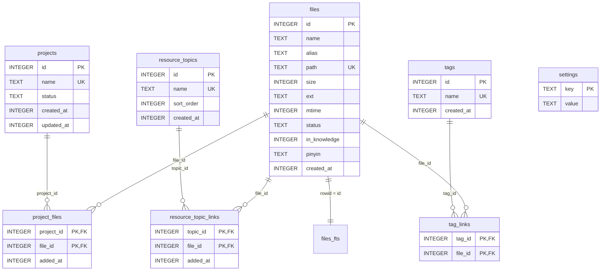
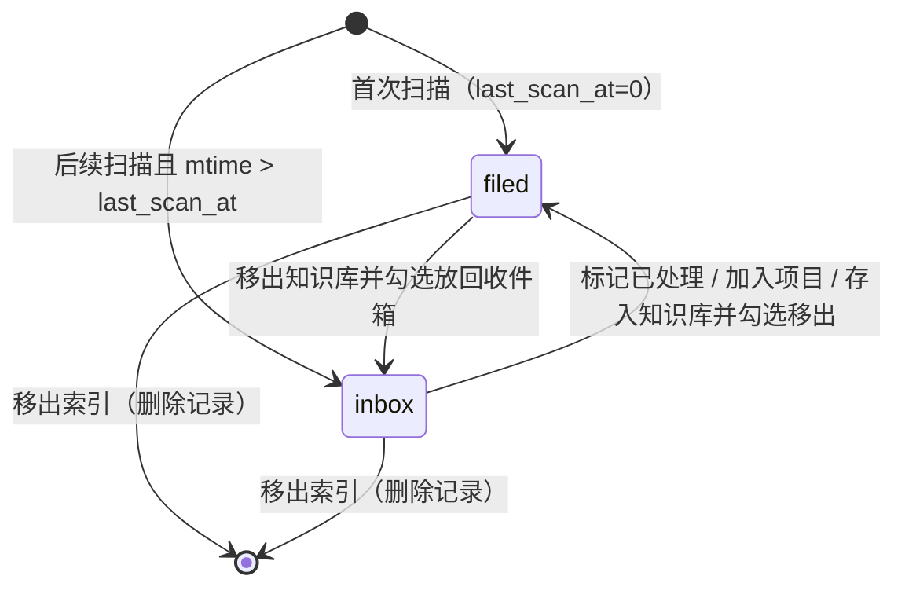

# 05 · 数据模型

数据库：SQLite（`better-sqlite3`），单文件 `app.db`。完整 DDL 位于 [electron/main/db/schema.ts](../../electron/main/db/schema.ts)，迁移入口为 [migrate.ts](../../electron/main/db/migrate.ts)。

## 1. 实体关系



共 8 张业务表 + 1 张 FTS5 虚拟表 `files_fts`。

## 2. 表结构明细

### 2.1 `files`（文件索引）

| 列 | 类型 | 约束/默认 | 说明 |
| --- | --- | --- | --- |
| `id` | INTEGER | PK AUTOINCREMENT | 内部 ID，也是 `weave-asset://file/<id>` 的标识 |
| `name` | TEXT | NOT NULL | 磁盘文件名（含扩展名） |
| `alias` | TEXT | NULL | 业务别名；列表显示优先 alias。**当前没有写入接口** |
| `path` | TEXT | NOT NULL UNIQUE | 绝对路径，冲突键 basis |
| `size` | INTEGER | NOT NULL | 字节 |
| `ext` | TEXT | NOT NULL | 小写、不含点；无扩展名为 `none` |
| `mtime` | INTEGER | NOT NULL | Unix ms |
| `status` | TEXT | NOT NULL DEFAULT `'filed'` | `inbox \| filed`（无 CHECK 约束） |
| `in_knowledge` | INTEGER | NOT NULL DEFAULT 0 | 0/1 布尔标记 |
| `pinyin` | TEXT | NOT NULL DEFAULT `''` | 文件名/别名的拼音首字母串 |
| `created_at` | INTEGER | NOT NULL | 首次入库时间（ms） |

索引：

| 索引 | 列 | 用途 |
| --- | --- | --- |
| `idx_files_status` | `status` | 收件箱筛选 |
| `idx_files_in_knowledge` | `in_knowledge` | 知识库筛选 |
| `idx_files_mtime` | `mtime` | 默认排序 |
| `idx_files_ext` | `ext` | 类型排序/筛选 |

### 2.2 `projects`

| 列 | 类型 | 约束 | 说明 |
| --- | --- | --- | --- |
| `id` | INTEGER | PK | |
| `name` | TEXT | NOT NULL UNIQUE | 1–50 字（Service 层校验） |
| `status` | TEXT | NOT NULL DEFAULT `'active'` | `active \| done` |
| `created_at` / `updated_at` | INTEGER | NOT NULL | ms；加入/移除文件会刷新 `updated_at` |

索引：`idx_projects_status`。列表排序 `updated_at DESC`。

### 2.3 `project_files`（项目 ⇄ 文件）

| 列 | 类型 | 约束 |
| --- | --- | --- |
| `project_id` | INTEGER | PK 组成，FK → `projects.id ON DELETE CASCADE` |
| `file_id` | INTEGER | PK 组成，FK → `files.id ON DELETE CASCADE` |
| `added_at` | INTEGER | NOT NULL，ms |

索引：`idx_project_files_file_id`（按文件反查）、`idx_project_files_added_at`（取最早加入项目）。

### 2.4 `resource_topics`（知识库专题）

| 列 | 类型 | 约束 | 说明 |
| --- | --- | --- | --- |
| `id` | INTEGER | PK | |
| `name` | TEXT | NOT NULL UNIQUE | 1–30 字 |
| `sort_order` | INTEGER | NOT NULL DEFAULT 0 | 新专题 = `MAX+1`；重排按下标重写 |
| `created_at` | INTEGER | NOT NULL | 同 `sort_order` 时按创建时间升序 |

### 2.5 `resource_topic_links`（专题 ⇄ 文件）

| 列 | 类型 | 约束 |
| --- | --- | --- |
| `topic_id` | INTEGER | PK 组成，FK → `resource_topics.id ON DELETE CASCADE` |
| `file_id` | INTEGER | PK 组成，FK → `files.id ON DELETE CASCADE` |
| `added_at` | INTEGER | NOT NULL |

索引：`idx_topic_links_file_id`。

### 2.6 `tags` 与 `tag_links`

- `tags`：`id` PK、`name` UNIQUE（1–20 字、禁止逗号）、`created_at`。
- `tag_links`：`(tag_id, file_id)` 复合主键，双外键级联；`idx_tag_links_file_id` 加速按文件查询。

### 2.7 `settings`

| 列 | 类型 | 说明 |
| --- | --- | --- |
| `key` | TEXT PK | 设置键 |
| `value` | TEXT | 统一字符串存储 |

当前键：`schema_version`、`last_scan_at`、`scan_root`。

## 3. FTS5 全文索引

```sql
CREATE VIRTUAL TABLE files_fts USING fts5(
  name, alias, pinyin,
  content='files',
  content_rowid='id',
  tokenize='unicode61'
);
```

- **external content 表**：不重复存储正文，`rowid` 对应 `files.id`。
- 三列：文件名、别名、拼音首字母。
- 分词器 `unicode61`，对中文按单字/连续字符切分；拼音列用于首字母命中。

### 3.1 同步触发器

| 触发器 | 行为 |
| --- | --- |
| `files_fts_after_insert` | 新行写入 FTS |
| `files_fts_after_update` | 先 `'delete'` 旧值，再插入新值 |
| `files_fts_after_delete` | `'delete'` 旧值 |

因此业务代码无需手动维护 FTS；`INSERT ... ON CONFLICT` 更新 `size/mtime` 时也会触发 update，但 FTS 内容不变，等价于重建该行索引。

> 历史修复：提交 `f7360ae` “修复 FTS5 搜索报 no such column: fts 错误”，说明搜索 SQL 曾直接使用非法的 `fts` 列；当前实现通过 `files_fts MATCH` + 子查询 `rowid` 关联。

### 3.2 搜索查询构造

[fileSvc.ts](../../electron/main/services/fileSvc.ts#L88-L146) 生成的子查询：

```sql
SELECT files_fts.rowid,
  CASE
    WHEN files_fts.name   LIKE ? THEN 1      -- 文件名前缀
    WHEN files_fts.pinyin LIKE ? THEN 1.5    -- 拼音前缀
    WHEN files_fts.name   LIKE ? THEN 2      -- 文件名包含
    WHEN files_fts.pinyin LIKE ? THEN 2.5    -- 拼音包含
    WHEN files_fts.alias  LIKE ? THEN 4      -- 别名包含
    ELSE 3
  END AS rank
FROM files_fts
WHERE files_fts MATCH ?
UNION
SELECT f.id AS rowid, 5 AS rank
FROM files f
JOIN tag_links tl ON tl.file_id = f.id
JOIN tags t ON t.id = tl.tag_id
WHERE LOWER(t.name) LIKE ?
  AND f.id NOT IN (SELECT rowid FROM files_fts WHERE files_fts MATCH ?)
```

参数顺序与 `?` 一一对应（[L130-L139](../../electron/main/services/fileSvc.ts#L130-L139)）：

1. `q%`（name 前缀）
2. `q%`（pinyin 前缀）
3. `%q%`（name 包含）
4. `%q%`（pinyin 包含）
5. `%q%`（alias 包含）
6. FTS 词项（每词 `"term"*`，空格分隔）
7. `%q%`（标签名包含）
8. FTS 词项（排除已命中）

外层按 `s.rank ASC, mtime DESC` 排序。搜索是全局的，不限制 inbox/project/kb。

## 4. 状态与旗标语义

### 4.1 `files.status`



- 收件箱 = `status='inbox'`，是“本次扫描新增/变更”的概念。
- 加入项目（`projectSvc.addFilesToProject`）与存入知识库（`moveOutOfInbox=true`）会隐式转 `filed`。
- 从项目移除**不会**恢复 `inbox`。
- 移出知识库时可选择 `toInbox=true` 强制回到收件箱。

### 4.2 `files.in_knowledge`

- 0 = 不在知识库；1 = 在知识库。
- 与“是否属于某个专题”独立：在知识库但无专题关联 → “未分类”。
- 删除专题不会改 `in_knowledge`，因此文件自动变为未分类。

### 4.3 `pathMissing`

非持久字段，由 `fileSvc` 在返回前 `fs.existsSync(path)` 计算（[L151-L162](../../electron/main/services/fileSvc.ts#L151-L162)）。因此：
- 文件被外部删除/移动不会自动从索引清理，只是标记为路径失效。
- 列表仍展示该行，打开/定位会被阻止。

## 5. 常用 SQL 与口径

### 5.1 项目文件计数

```sql
SELECT p.id, ..., COUNT(pf.file_id) AS file_count
FROM projects p
LEFT JOIN project_files pf ON pf.project_id = p.id
GROUP BY p.id
```

### 5.2 专题文件计数

```sql
SELECT rt.id, ..., COUNT(rtl.file_id) AS file_count
FROM resource_topics rt
LEFT JOIN resource_topic_links rtl ON rtl.topic_id = rt.id
GROUP BY rt.id
ORDER BY rt.sort_order ASC, rt.created_at ASC
```

### 5.3 未分类计数（Service 内实现，当前未被 IPC 使用）

```sql
SELECT COUNT(*) FROM files f
WHERE f.in_knowledge = 1
  AND NOT EXISTS (SELECT 1 FROM resource_topic_links rtl WHERE rtl.file_id = f.id)
```

渲染端实际通过 `fileApi.list({kind:'kb-uncategorized'})` 的长度计算，两者口径一致。

### 5.4 标签聚合

`getTagsForFiles(ids)` 一次 `IN (...)` 查询后在内存按 `file_id` 分组，避免 N+1 查询（[tagSvc.ts L98-L121](../../electron/main/services/tagSvc.ts#L98-L121)）。

## 6. 数据一致性策略

| 策略 | 实现 |
| --- | --- |
| 外键级联 | `PRAGMA foreign_keys = ON`；删除文件 → 清理所有关联；删除项目/专题 → 清理关联 |
| 批量写事务 | 扫描每 100 条、项目/知识库/标签批量操作均在 `db.transaction` 内 |
| 幂等关联 | `INSERT OR IGNORE` 处理重复添加 |
| 唯一约束 | `path`、项目名、专题名、标签名 |
| 并发 | WAL 模式；`better-sqlite3` 同步 API 在主进程串行执行 |
| 搜索一致 | 触发器保证 `files_fts` 与 `files` 同步 |

## 7. 迁移与版本

- `SCHEMA_VERSION = '1'`，写入 `settings.schema_version`。
- 当前 `migrate()` 对版本不一致只做“覆盖版本号”，没有逐版本 `ALTER TABLE` 逻辑（[migrate.ts L30-L36](../../electron/main/db/migrate.ts#L30-L36)）。
- 添加字段时需要：
  1. 在 `SCHEMA_SQL` 的 `CREATE TABLE` 中加列（仅对新库生效）；
  2. 在 `migrate()` 中为旧库补 `ALTER TABLE ... ADD COLUMN`；
  3. 提升 `SCHEMA_VERSION` 并写迁移分支。
- 由于 `CREATE TABLE IF NOT EXISTS` 不会改旧表结构，现阶段的 schema 演进必须依赖显式迁移。

## 8. 数据文件与备份

| 环境 | 路径 |
| --- | --- |
| 开发 | `<仓库>/.localdb/app.db`（另有 WAL/SHM 旁路文件） |
| 打包 | `%APPDATA%\<应用名>\app.db`（`app.getPath('userData')`） |

备份时需同时处理 `app.db`、`app.db-wal`（如存在）；直接复制主文件可能丢失 WAL 中未 checkpoint 的数据。
