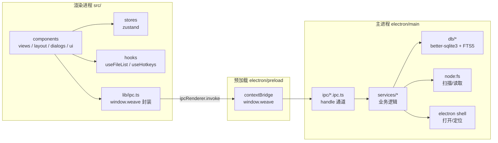

# Weave 工作台 · Code Wiki

> 本仓库 `package.json` 名为 `file-organizer`，应用内产品名为 **Weave 工作台**。这是一套面向开发者与维护者的代码 Wiki，说明项目架构、模块职责、关键类/函数、依赖关系、数据模型、IPC 契约以及运行方式。

## 1. 项目速览

| 维度 | 内容 |
| --- | --- |
| 应用形态 | Electron 桌面应用（主进程 Node.js + 渲染进程 React） |
| 业务目标 | 本地办公文件整理：扫描索引、收件箱、项目归类、知识库专题、标签、搜索 |
| 版本 | `0.1.0`（[package.json](../../package.json)） |
| 主进程入口 | `dist-electron/main/index.js`（源码 [electron/main/index.ts](../../electron/main/index.ts)） |
| 预加载脚本 | `dist-electron/preload/index.mjs`（源码 [electron/preload/index.ts](../../electron/preload/index.ts)） |
| 渲染进程入口 | [src/main.tsx](../../src/main.tsx) → [src/App.tsx](../../src/App.tsx) → [AppShell](../../src/components/layout/AppShell.tsx) |
| 数据存储 | SQLite（`better-sqlite3`），WAL 模式 + FTS5 全文检索 |
| 前端技术 | React 19、TypeScript、Tailwind CSS v4、Zustand 5、TanStack Virtual |
| 构建 | Vite 8 + `vite-plugin-electron`，`electron-builder` 打包 |
| 平台重点 | Windows（README 明确定位），构建配置同时支持 macOS |
| 数据库对象 | 8 张业务表 + 1 张 FTS5 虚拟表 |
| IPC 通道常量 | 36 个（其中 34 个注册为 `ipcMain.handle`，2 个为事件/未使用） |

## 2. 当前能力矩阵

已实现（代码可运行）：

- 递归扫描指定根目录，建立文件索引，记录大小/修改时间/扩展名/拼音首字母。
- 收件箱（`files.status = 'inbox'`）、标记已处理、批量移出索引。
- 项目管理：创建、重命名、删除、进行中/已完成状态、添加/移除文件。
- 知识库：专题创建/重命名/删除/排序，文件存入/移出知识库，加入/移出专题。
- 标签：创建、批量打标签、批量移除标签。
- 全局搜索：FTS5 前缀匹配 + 文件名/拼音/别名/标签的子串匹配与权重排序。
- 文件列表：虚拟滚动、多选（单选/Ctrl/Shift/Ctrl+A）、键盘导航、右键菜单。
- 文件操作：用系统程序打开、在文件夹中定位、路径失效检测、大于 100MB 提示。
- 设置：选择扫描根目录、查看数据库路径与版本。
- 自定义协议 `weave-asset://`（主进程已实现，渲染进程暂未接入实际内容渲染）。
- 自动更新（主进程已接线 `electron-updater`，渲染进程更新 UI 为模板遗留、未挂载）。

尚未实现（README 路线图/描述与代码不符）：

- 本地 AI（Ollama）生成文件名与标签建议（依赖中无 Ollama 客户端）。
- 文件重命名建议的应用。
- 物理移动文件与批次撤销。
- 二进制内容预览（PDF/图片/Word/Excel），当前仅展示元数据卡片。

详细差异见 [09-conventions-and-gaps.md](09-conventions-and-gaps.md)。

## 3. 文档导航

| 文档 | 内容 | 适合谁 |
| --- | --- | --- |
| [01-architecture.md](01-architecture.md) | 整体架构、进程边界、启动时序、数据流、关键设计决策 | 所有人，先读 |
| [02-project-structure.md](02-project-structure.md) | 目录树、文件职责清单、路径别名、构建产物 | 新加入的开发者 |
| [03-main-process.md](03-main-process.md) | 主进程启动、数据库层、六大 Service、IPC 注册、资源协议、自动更新 | 后端/主进程维护者 |
| [04-renderer.md](04-renderer.md) | React 入口、布局、视图、列表基础设施、Zustand Store、对话框、UI 原子组件 | 前端维护者 |
| [05-data-model.md](05-data-model.md) | 表结构、索引、FTS5 与触发器、状态语义、SQL 查询模式、迁移 | 数据/功能开发 |
| [06-ipc-api.md](06-ipc-api.md) | 通道总表、`window.weave` API、事件通道、错误语义、安全边界 | 跨进程联调 |
| [07-running-and-build.md](07-running-and-build.md) | 环境要求、脚本、开发/构建/打包、数据库位置、CI、故障排查 | 需要跑起来的人 |
| [08-testing-and-quality.md](08-testing-and-quality.md) | Vitest、Playwright、类型检查现状、测试缺口 | 提测/CI 维护 |
| [09-conventions-and-gaps.md](09-conventions-and-gaps.md) | 编码约定、功能完成度、已知缺陷与技术债 | 评审/规划 |

推荐阅读路径：

- 快速上手：本页 → 07 → 02
- 改业务功能：01 → 05 → 06 → 03/04
- 排查问题：07 的故障排查 → 08 → 09

## 4. 系统一句话

Electron 主进程负责“扫描磁盘 + 管理 SQLite”，通过类型化 IPC 暴露给渲染进程；渲染进程 React 只负责视图与交互，所有持久化状态都在 SQLite 中，磁盘文件本身不被修改（仅打开/定位）。

## 5. 依赖关系总览

## 6. 共享契约（跨进程的唯一事实来源）

- 通道名：[src/shared/ipc-contract.ts](../../src/shared/ipc-contract.ts)
- 数据类型：[src/shared/types.ts](../../src/shared/types.ts)
- 渲染端类型声明：[src/types/weave-api.d.ts](../../src/types/weave-api.d.ts)

任何新增 IPC 都应同时更新以上三处，抽取值见 [06-ipc-api.md](06-ipc-api.md)。
