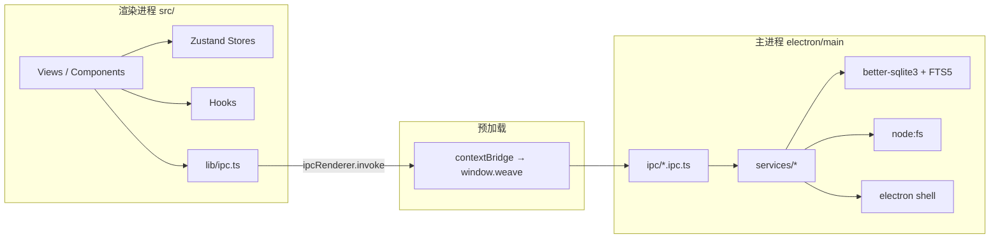

# Weave 工作台（file-organizer）项目现状分析报告

> 分析时间：2026-10-25  
> 分析对象：`d:\Projects\file-organizer` 工作区（包含未提交改动）  
> 分析方式：逐层阅读 Electron 主进程、preload、React 渲染进程、SQLite Schema 与 IPC 契约，并运行 TypeScript 类型检查进行核对。  
> 重要说明：仓库目前只有基础设施相关提交，绝大多数业务代码仍处于未提交/未跟踪状态（见 `git status`）。因此本报告以**工作区实际代码**为准，而不是 Git HEAD。

---

## 一、结论摘要

这个项目已经不是一个空壳模板，而是一个**功能闭环基本跑通的本地文件整理桌面应用 MVP**：

- 用户可以选择一个磁盘根目录，递归扫描并建立文件索引；
- 新文件默认进入「收件箱」，也可以直接从系统资源管理器把文件拖进收件箱；
- 文件可以被虚拟地归类到「项目」「知识库专题」，并打标签；
- 提供基于 SQLite FTS5 + 拼音首字母 + 标签的全局搜索；
- 文件列表支持虚拟滚动、多选、快捷键、右键菜单；
- 所有归类都只改数据库，不移动、不修改、不重命名磁盘文件；
- 数据全部保存在本地 SQLite，不依赖云服务。

整体判断：**MVP 的主流程已经完成，可以日常试用；但交互细节与工程质量仍有若干明确缺陷，其中「用系统程序打开」和「排序」是会影响实际使用的高优先级问题。**

---

## 二、技术栈与运行架构

### 2.1 技术栈

| 维度 | 现状 |
| --- | --- |
| 应用形态 | Electron 桌面应用（主进程 Node.js + 渲染进程 React） |
| 前端 | React 19、TypeScript、Tailwind CSS v4、Zustand 5、TanStack Virtual |
| 主进程 | Electron 42、Node.js、better-sqlite3（同步 SQLite） |
| 数据库 | 本地 SQLite，WAL 模式 + FTS5 全文索引 |
| 构建 | Vite 8 + `vite-plugin-electron`，`electron-builder` 打包 |
| 打包目标 | Windows NSIS x64；配置中也保留了 macOS dmg/zip |
| 测试 | Vitest 单元测试（仅冒烟）、Playwright E2E（仍针对旧模板 UI） |

### 2.2 三层进程结构

应用采用标准且安全的 Electron 分层，窗口开启了 `contextIsolation: true`、`nodeIntegration: false`（[index.ts](file:///d:/Projects/file-organizer/electron/main/index.ts#L49-L62)）。

| 层 | 目录 | 职责 |
| --- | --- | --- |
| 主进程 | `electron/main/` | 窗口生命周期、磁盘扫描、SQLite 读写、系统 Shell、自定义协议、自动更新 |
| 预加载 | `electron/preload/` | 通过 `contextBridge` 只暴露白名单 API `window.weave` |
| 渲染进程 | `src/` | React 视图、交互状态、展示与格式化；不直接访问 Node/DB |



### 2.3 启动链路

1. 主进程设置 `APP_ROOT`、单实例锁。
2. 在 `app.ready` 之前注册特权协议 `weave-asset`（Electron 要求）。
3. `app.whenReady()` 后注册协议处理器、初始化数据库（执行建表与迁移）、注册全部 IPC。
4. 创建 1200×760 的「Weave 工作台」窗口。
5. preload 注入 `window.weave`。
6. React 挂载 `AppShell`，首次加载收件箱数量、项目、专题、知识库计数、标签。
7. 开发模式自动打开 DevTools；生产模式加载 `dist/index.html`。

启动实现见 [index.ts](file:///d:/Projects/file-organizer/electron/main/index.ts#L83-L93)，IPC 注册总入口见 [register.ts](file:///d:/Projects/file-organizer/electron/main/ipc/register.ts#L9-L16)。

### 2.4 安全边界

- 渲染进程无法直接使用 `ipcRenderer`，只能调用 preload 暴露的 `window.weave`。
- 前端所有 IPC 调用统一经 [lib/ipc.ts](file:///d:/Projects/file-organizer/src/lib/ipc.ts#L1-L12) 包装，不直接访问 `window.weave`。
- 主进程对磁盘文件只有 `stat`、`readFile`（预览协议）、`shell.openPath`、`shell.showItemInFolder`，没有删除/移动/重命名操作。
- 外部链接一律交给系统浏览器打开，窗口内禁止新开页面。

---

## 三、已实现功能与实现方法

### 3.1 功能总览

| 功能域 | 已实现能力 | 主要入口 |
| --- | --- | --- |
| 扫描与索引 | 选择根目录、递归扫描、估算总数、进度事件、取消、批量入库、记录上次扫描时间 | 设置页 |
| 收件箱 | 展示 `status='inbox'` 的文件、批量标记已处理、拖入外部文件建立索引 | 侧栏「收件箱」 |
| 项目 | 新建、重命名、删除、进行中/已完成、添加/移除文件、按状态筛选 | 侧栏「项目」 |
| 知识库 | 全部资料、未分类、专题新建/重命名/删除、存入/移出知识库、加入/移出专题 | 侧栏「知识库」 |
| 标签 | 新建标签、批量打标签（追加语义） | 文件右键菜单 |
| 搜索 | FTS5 前缀匹配 + 文件名/拼音/别名/标签子串匹配 + 权重排序 | 顶栏搜索框 |
| 文件列表 | 虚拟滚动、单选/Ctrl 多选/Shift 连选/Ctrl+A、↑↓ 导航、Enter 打开、Delete 移出索引、右键菜单 | 各列表视图 |
| 文件操作 | 系统程序打开、在文件夹中定位、路径失效提示、100MB 大文件提示 | 双击 / 右键 / 预览面板 |
| 预览 | 元数据卡片（类型、大小、修改时间、路径） | 右侧预览面板 |
| 设置 | 查看/更换扫描根目录、查看数据库路径、查看版本、上次扫描时间 | 设置页 |
| 数据修复 | 一次性把历史误标为 `filed` 且未归类的文件放回收件箱 | 启动迁移自动执行 |
| 基础设施 | `weave-asset://` 自定义协议（主进程）、`electron-updater`（主进程） | 后端已接线 |

### 3.2 扫描与索引：如何实现

核心逻辑在 [scanner.ts](file:///d:/Projects/file-organizer/electron/main/services/scanner.ts)。

1. **读取扫描根目录**：从 `settings` 表的 `scan_root` 读取；未设置、不存在、无读权限都会抛出明确错误。
2. **单实例扫描锁**：模块级 `scanning` 变量防止并发扫描；`cancelScan()` 通过 `cancelled` 标志中止遍历。
3. **预估总数**：先递归 `countFiles` 统计文件数，用于进度条。
4. **状态快照**：扫描前一次性读取 `files` 表的 `path → status` 映射（[L52-L56](file:///d:/Projects/file-organizer/electron/main/services/scanner.ts#L52-L56)）。
5. **状态判定**（[L130-L135](file:///d:/Projects/file-organizer/electron/main/services/scanner.ts#L130-L135)）：
   - 新文件 → `inbox`
   - 上次扫描之后修改过的文件 → `inbox`
   - 原本就在收件箱中的文件 → `inbox`
   - 其余已有文件 → 保持 `filed`
6. **批量写入**：每 100 条执行一次事务，使用 `INSERT ... ON CONFLICT(path) DO UPDATE SET size, mtime, status`（[L70-L105](file:///d:/Projects/file-organizer/electron/main/services/scanner.ts#L70-L105)）。
7. **索引字段**：计算文件名（去扩展名）的拼音首字母写入 `files.pinyin`，供 FTS 搜索。
8. **进度推送**：每处理 10 个文件，通过 `scan:progress` 事件推送到渲染进程。
9. **完成**：写入 `last_scan_at`，返回 `{ scanned, added, skipped }`。

跳过规则：隐藏文件/目录（以 `.` 开头）、`$RECYCLE.BIN`、`System Volume Information`；无权限目录静默跳过。

### 3.3 收件箱与拖拽导入：如何实现

**收件箱查询**：统一走 `fileSvc.listFiles({ kind: 'inbox' }, sort)`，即 `WHERE f.status = 'inbox'`（[fileSvc.ts L24-L27](file:///d:/Projects/file-organizer/electron/main/services/fileSvc.ts#L24-L27)）。

**标记已处理**：`UPDATE files SET status='filed' WHERE id IN (...) AND status='inbox'`（[L218-L226](file:///d:/Projects/file-organizer/electron/main/services/fileSvc.ts#L218-L226)）。

**从系统拖入文件**（[InboxView.tsx L57-L109](file:///d:/Projects/file-organizer/src/components/views/InboxView.tsx#L57-L109)）：

1. 监听 `dragover/dragleave/drop`，仅接受 `Files` 类型。
2. 通过 preload 暴露的 `webUtils.getPathForFile(file)` 获取真实磁盘路径（Electron 32+ 已移除 `File.path`，这是官方替代方案，见 [preload/index.ts L29-L31](file:///d:/Projects/file-organizer/electron/preload/index.ts#L29-L31)）。
3. 调用 `file:indexPaths`，主进程 [indexPaths](file:///d:/Projects/file-organizer/electron/main/services/fileSvc.ts#L232-L280) 执行：
   - 路径去重、去除空值；
   - `statSync` 校验，文件夹计入失败并跳过；
   - 已存在路径则更新大小/修改时间并重新置为 `inbox`；
   - 新路径插入并默认 `inbox`；
   - 全程一个事务。
4. 返回 `{ ok, fail }`，界面刷新列表与收件箱数量，并用 Toast 提示结果。

**历史数据修复**：旧版本首次扫描曾把所有文件写成 `filed`，导致收件箱为空。启动迁移中增加了 `backfillInbox`（[migrate.ts L46-L61](file:///d:/Projects/file-organizer/electron/main/db/migrate.ts#L46-L61)），用 `inbox_backfill_v1` 标记保证只执行一次，把「未进知识库且不属于任何项目」的 `filed` 文件放回收件箱。

### 3.4 项目管理：如何实现

服务层在 [projectSvc.ts](file:///d:/Projects/file-organizer/electron/main/services/projectSvc.ts)。

- **列表**：`projects LEFT JOIN project_files`，聚合 `fileCount`，按 `updated_at DESC` 排序，支持 `all/active/done` 过滤。
- **创建/重命名**：名称去空格，限制 1–50 字，服务层检查重名。
- **删除**：删除 `projects` 行，`project_files` 依靠外键 `ON DELETE CASCADE` 自动清理，磁盘文件不受影响。
- **状态**：`active/done`，同时更新 `updated_at`。
- **添加文件**：`INSERT OR IGNORE` 关联，并把文件 `status` 从 `inbox` 改为 `filed`（[L135-L154](file:///d:/Projects/file-organizer/electron/main/services/projectSvc.ts#L135-L154)）。
- **移除文件**：删除关联并更新项目时间。

前端：项目列表是卡片网格，支持右键重命名/删除；详情页可切换状态、添加文件、查看关联文件（[ProjectsView.tsx](file:///d:/Projects/file-organizer/src/components/views/ProjectsView.tsx)、[ProjectDetailView.tsx](file:///d:/Projects/file-organizer/src/components/views/ProjectDetailView.tsx)）。

### 3.5 知识库：如何实现

服务层在 [kbSvc.ts](file:///d:/Projects/file-organizer/electron/main/services/kbSvc.ts)。

- **两层结构**：
  - 「是否在知识库」用 `files.in_knowledge` 表示；
  - 「属于哪个专题」用 `resource_topic_links` 关联表表示。
- **全部资料**：`in_knowledge = 1`。
- **未分类**：`in_knowledge = 1` 且不存在任何专题关联。
- **专题**：`resource_topics` 按 `sort_order` 排序，列表聚合 `fileCount`。
- **存入知识库**（[L106-L135](file:///d:/Projects/file-organizer/electron/main/services/kbSvc.ts#L106-L135)）：设置 `in_knowledge=1`，按需插入专题关联，按需把文件移出收件箱。
- **移出知识库**（[L140-L160](file:///d:/Projects/file-organizer/electron/main/services/kbSvc.ts#L140-L160)）：`in_knowledge=0`，删除全部专题关联，按需放回收件箱。
- **加入/移出专题**：`INSERT OR IGNORE` / 删除关联。
- **删除专题**：只删专题，文件回到「未分类」，`in_knowledge` 仍为 1。

前端：左侧固定专题栏（全部资料/未分类/专题列表/新建专题），右侧复用统一文件列表（[KnowledgeBaseView.tsx](file:///d:/Projects/file-organizer/src/components/views/KnowledgeBaseView.tsx)）。

### 3.6 标签：如何实现

服务层在 [tagSvc.ts](file:///d:/Projects/file-organizer/electron/main/services/tagSvc.ts)。

- 标签名限制 1–20 字，不允许逗号，重名时 `INSERT OR IGNORE` 并返回已有标签。
- 打标签是**追加语义**：`tag_links` 用 `INSERT OR IGNORE`，不会覆盖已有标签。
- 文件列表查询时批量 `getTagsForFiles`，按文件 ID 分组返回，避免 N+1 查询。
- 前端通过右键菜单「打标签」选择已有标签，或直接输入新标签名创建并绑定（[GlobalContextMenu.tsx L145-L215](file:///d:/Projects/file-organizer/src/components/layout/GlobalContextMenu.tsx#L145-L215)）。

### 3.7 全局搜索：如何实现

核心在 [fileSvc.buildSearchQuery](file:///d:/Projects/file-organizer/electron/main/services/fileSvc.ts#L90-L148)。

搜索由两条 SQL 通过 `UNION` 组合：

1. **FTS5 前缀匹配**：把查询按空格分词，每个词加 `*`，匹配 `files_fts`（文件名、别名、拼音）。
2. **标签子串匹配**：`LOWER(tags.name) LIKE %q%`，且排除已被 FTS 命中的文件。

权重（数值越小越靠前）：

| 命中方式 | rank |
| --- | --- |
| 文件名前缀 | 1 |
| 拼音前缀 | 1.5 |
| 文件名包含 | 2 |
| 拼音包含 | 2.5 |
| 仅 FTS 命中 | 3 |
| 别名包含 | 4 |
| 标签包含 | 5 |

最终按 `rank ASC, mtime DESC` 排序。前端顶栏输入有 200ms 防抖，查询为空时自动回到收件箱视图；结果页通过 `ErrorBoundary` 兜底（[SearchResultsView.tsx](file:///d:/Projects/file-organizer/src/components/views/SearchResultsView.tsx)）。

拼音能力由 `pinyin-pro` 生成首字母（[pinyin.ts](file:///d:/Projects/file-organizer/electron/main/util/pinyin.ts)），例如「项目计划书.pdf」索引为 `xmjhs`。

### 3.8 文件列表与交互：如何实现

统一列表组件 [FileList.tsx](file:///d:/Projects/file-organizer/src/components/filelist/FileList.tsx)：

- **虚拟滚动**：`@tanstack/react-virtual`，固定行高 36px，`overscan=10`，面向大文件量。
- **多选**：单选、Ctrl/Cmd 切换、Shift 范围选择、表头全选、Ctrl+A。
- **选择隔离**：选择状态存在 `useSelectionStore.byKey`，按 `listKey` 隔离。同一文件可以同时出现在搜索、项目、知识库中，各列表的选择互不干扰（[useSelectionStore.ts](file:///d:/Projects/file-organizer/src/stores/useSelectionStore.ts#L32-L124)）。
- **快捷键**（[useHotkeys.ts](file:///d:/Projects/file-organizer/src/hooks/useHotkeys.ts#L28-L86)）：↑↓ 移动焦点、Enter 打开、Delete/Backspace 移出索引、Esc 清空选择、Ctrl+A 全选。输入框内不触发。
- **右键菜单**：全局唯一 `GlobalContextMenu`，根据场景（收件箱/项目/知识库/搜索）展示不同菜单项。
- **双击**：调用系统程序打开；路径失效时直接忽略。
- **加载/空态**：骨架屏 + 空状态组件。

列表数据统一由 [useFileList.ts](file:///d:/Projects/file-organizer/src/hooks/useFileList.ts#L24-L95) 获取，所有视图共用 `fileSvc.listFiles`。

### 3.9 打开、定位与预览

- **打开**：主进程 `openFile` 调用 `shell.openPath`（[fileSvc.ts L285-L295](file:///d:/Projects/file-organizer/electron/main/services/fileSvc.ts#L285-L295)）。注意：这里存在一个真实缺陷，见第八节。
- **定位**：`shell.showItemInFolder`，路径失效时返回 `false`。
- **路径失效检测**：列表返回前对每一行执行 `fs.existsSync`，前端显示「⚠ 路径失效」（[fileSvc.ts L153-L164](file:///d:/Projects/file-organizer/electron/main/services/fileSvc.ts#L153-L164)）。
- **大文件保护**：预览面板对超过 100MB 的文件只显示提示，不加载内容。
- **预览现状**：`PreviewPane` 调用 `previewMeta` 获取元数据，交给 `UnsupportedPreview` 展示类型/大小/时间/路径，并提供打开、定位按钮。**当前没有渲染 PDF/图片/Word/Excel 的真实内容。**
- **自定义协议**：主进程已实现 `weave-asset://file/<id>`，按文件 ID 读取本地内容，限制 100MB，按扩展名返回 MIME（[assetProtocol.ts](file:///d:/Projects/file-organizer/electron/main/preview/assetProtocol.ts#L51-L89)）。但渲染进程尚未使用该协议加载真实内容。

### 3.10 设置

设置页（[SettingsView.tsx](file:///d:/Projects/file-organizer/src/components/views/SettingsView.tsx)）通过 IPC 读写 `settings` 表：

- 选择/更换扫描根目录（`dialog.showOpenDialogSync`）；
- 开始扫描/取消扫描，显示进度条、当前路径、已处理数量；
- 显示上次扫描时间、数据库路径、应用版本。

数据库位置（[db-path.ts](file:///d:/Projects/file-organizer/electron/main/db-path.ts#L10-L21)）：

- 开发环境：项目根目录 `.localdb/app.db`；
- 生产环境：`app.getPath('userData')/app.db`。

### 3.11 数据库初始化与迁移

- 单例 `getDb()` 首次调用时打开数据库并执行迁移（[db/index.ts](file:///d:/Projects/file-organizer/electron/main/db/index.ts#L11-L18)）。
- 迁移开启 `WAL` 与 `foreign_keys=ON`，执行建表 SQL，写入 `schema_version` 与 `last_scan_at`。
- 当前 `SCHEMA_VERSION = '1'`；版本不一致时只更新版本号，尚无逐版本迁移脚本。
- 启动时执行一次 `backfillInbox` 历史数据修复。

### 3.12 自定义协议与自动更新

- `weave-asset`：主进程完整实现，渲染端未接线。
- 自动更新：主进程已用 `electron-updater` 接线检查更新、下载进度、取消、安装（[update.ts](file:///d:/Projects/file-organizer/electron/main/update.ts#L14-L81)）。未打包时检查更新直接返回错误；渲染端的更新 UI 组件是模板遗留，**没有挂载到应用**，且依赖未暴露的 `window.ipcRenderer`。

---

## 四、数据模型

Schema 定义在 [schema.ts](file:///d:/Projects/file-organizer/electron/main/db/schema.ts)。

### 4.1 表结构

| 表 | 作用 | 关键字段 |
| --- | --- | --- |
| `files` | 文件索引主表 | `path` 唯一、`size`、`ext`、`mtime`、`status`、`in_knowledge`、`pinyin` |
| `projects` | 项目 | `name` 唯一、`status`、`updated_at` |
| `project_files` | 项目-文件关联 | 复合主键、外键级联删除 |
| `resource_topics` | 知识库专题 | `name` 唯一、`sort_order` |
| `resource_topic_links` | 专题-文件关联 | 复合主键、外键级联删除 |
| `tags` | 标签 | `name` 唯一 |
| `tag_links` | 标签-文件关联 | 复合主键、外键级联删除 |
| `settings` | 键值配置 | `scan_root`、`last_scan_at`、`schema_version` 等 |
| `files_fts` | FTS5 虚拟表 | 索引 `name / alias / pinyin` |

### 4.2 状态语义

| 字段 | 取值 | 含义 |
| --- | --- | --- |
| `files.status` | `inbox` | 待在收件箱处理 |
| | `filed` | 已处理（通常因为进入了项目或知识库） |
| `files.in_knowledge` | `0 / 1` | 是否在知识库 |
| `projects.status` | `active / done` | 进行中 / 已完成 |

### 4.3 FTS 同步

`files_fts` 使用 external content（`content='files'`, `content_rowid='id'`），并有 `AFTER INSERT / UPDATE / DELETE` 三个触发器自动同步，无需手工维护索引。

### 4.4 虚拟归类，不动物理文件

项目、知识库、标签全部是数据库关联：

- 加入项目：写 `project_files`，并把 `status` 改为 `filed`；
- 加入知识库：`in_knowledge=1`，可写专题关联，可移出收件箱；
- 打标签：写 `tag_links`；
- 移出索引：只删 `files` 行，磁盘文件不动；
- 删除项目/专题/标签：外键级联清理关联，磁盘文件不动。

这是项目最重要的产品约束，代码整体遵守得很好。

---

## 五、IPC 契约

通道常量集中在 [ipc-contract.ts](file:///d:/Projects/file-organizer/src/shared/ipc-contract.ts)，类型在 [types.ts](file:///d:/Projects/file-organizer/src/shared/types.ts)，渲染端声明在 [weave-api.d.ts](file:///d:/Projects/file-organizer/src/types/weave-api.d.ts)。

实际统计：

- 共 **37** 个通道常量；
- 其中 **35** 个注册为 `ipcMain.handle`；
- `scan:progress` 是主进程 → 渲染进程的单向事件；
- `scan:result` 常量已定义但未使用（扫描结果直接通过 `invoke` 返回）；
- 自动更新另有 4 个独立通道：`check-update`、`start-download`、`cancel-download`、`quit-and-install`。

| 分组 | 通道数 | 说明 |
| --- | --- | --- |
| scan | 2 handler + 1 event | 扫描、取消、进度 |
| file | 8 | 列表、单条、移出、标记已处理、打开、定位、预览元数据、拖入索引 |
| project | 7 | 列表/创建/重命名/删除/状态/加文件/移文件 |
| kb | 9 | 专题列表/创建/重命名/删除/排序 + 知识库/专题的增删 |
| tag | 4 | 列表/创建/批量打/批量移 |
| settings | 5 | 读取/写入/选目录/数据库路径/版本 |

IPC Handler 层只做参数解包与 Service 调用，业务逻辑在 `services/`，分层清晰。

---

## 六、前端状态与列表机制

| Store | 职责 |
| --- | --- |
| `useUiStore` | 当前视图、当前项目、知识库选中项、侧栏、预览面板、搜索词、右键菜单、模态框、Toast |
| `useDataStore` | 收件箱数量、项目列表与筛选、专题、知识库计数、标签 |
| `useSelectionStore` | 按 `listKey` 隔离的选择集合、锚点、焦点 |

关键设计：

- **视图状态与数据状态分离**：切换视图不会触发全量数据刷新。
- **选择按列表实例隔离**：同一文件在不同列表中的选择互不影响。
- **统一列表 Hook**：`useFileList` 负责查询、排序状态、加载/错误、刷新。
- **统一 IPC 包装**：`src/lib/ipc.ts` 暴露 `scanApi/fileApi/projectApi/kbApi/tagApi/settingsApi`。

---

## 七、功能完成度矩阵

| 能力 | 状态 | 说明 |
| --- | --- | --- |
| 根目录扫描与索引 | ✅ 已实现 | 递归、批量事务、进度、取消 |
| 收件箱 | ✅ 已实现 | 查询、标记已处理、右键操作 |
| 外部拖入文件 | ✅ 已实现 | 路径校验、文件夹跳过、重复更新并回收入件箱 |
| 项目 CRUD/状态/加移除文件 | ✅ 已实现 | 卡片列表 + 详情页 |
| 知识库/专题 | ✅ 已实现 | 全部/未分类/专题、存入/移出、专题 CRUD |
| 标签创建与打标签 | ✅ 已实现 | 追加语义 |
| 全局搜索 | ✅ 已实现 | FTS5 + 拼音 + 标签 + 权重 |
| 列表虚拟滚动/多选/快捷键 | ✅ 已实现 | 行高 36，按列表隔离选择 |
| 打开/定位/失效检测 | ⚠️ 部分 | 定位正常；打开存在 Promise 序列化缺陷 |
| 元数据预览 | ⚠️ 部分 | 仅元数据卡片，无真实内容 |
| 排序 | ⚠️ 部分 | 表头/下拉改变状态，但多数视图不会重新查询 |
| 预览跟随选中项 | ❌ 未实现 | 预览绑定右键菜单第一项，左键/键盘不更新 |
| 标签移除 UI | ❌ 未实现 | 后端 `tag:removeFromFiles` 已有，无界面 |
| 专题拖拽排序 UI | ❌ 未实现 | 后端 `kb:reorderTopics` 已有，无界面 |
| 别名/重命名建议 | ❌ 未实现 | `alias` 字段存在，但没有任何写入入口 |
| 真实内容预览 | ❌ 未实现 | `mammoth`、`pdfjs-dist`、`xlsx` 已安装但未使用 |
| 物理移动/重命名文件 | ❌ 未实现 | 明确的产品非目标 |
| 批次撤销 | ❌ 未实现 | 无操作历史 |
| AI 文件命名/标签建议 | ❌ 未实现 | 无 Ollama/HTTP 客户端依赖 |
| 文件监听/增量同步 | ❌ 未实现 | 只能手动扫描 |
| 自动更新 UI | ⚠️ 半成品 | 主进程已接线，渲染端模板组件未挂载 |

---

## 八、已知问题与风险（均已核对代码）

### P1：会直接影响核心使用

#### 1. 「用系统程序打开」的 IPC 返回值不可序列化

证据：[fileSvc.ts L285-L295](file:///d:/Projects/file-organizer/electron/main/services/fileSvc.ts#L285-L295)

```ts
export function openFile(id: number): { ok: boolean; reason?: string } {
  ...
  const result = shell.openPath(file.path);
  if (result) {
    return { ok: false, reason: result };
  }
  return { ok: true };
}
```

`shell.openPath` 在 Electron 中返回 `Promise<string>`，但这里既没有 `await`，也没有把函数声明为 `async`。因此：

- 文件通常仍会被系统打开（副作用已发生）；
- 但返回对象里的 `reason` 是一个 Promise，`ipcMain.handle` 无法用结构化克隆序列化它，渲染端 `await fileApi.open(...)` 会失败/报错；
- 用户无法得到正确的失败提示，右键「用系统程序打开」路径会出现未处理异常。

`npx tsc -p tsconfig.node.json --noEmit` 也直接报出：

```text
electron/main/services/fileSvc.ts(292,25): error TS2322:
  Type 'Promise<string>' is not assignable to type 'string'.
```

#### 2. 排序表头在多数视图不会真正重新查询

证据：[useFileList.ts L29-L33](file:///d:/Projects/file-organizer/src/hooks/useFileList.ts#L29-L33) 与 [InboxView.tsx L27-L46](file:///d:/Projects/file-organizer/src/components/views/InboxView.tsx#L27-L46)

`useFileList` 内部只在初始化时读取 `defaultSort`：

```ts
const [sort, setSort] = useState<FileSort>(defaultSort);
```

而 InboxView / KnowledgeBaseView / ProjectDetailView / SearchResultsView 都在视图里维护自己的 `sortKey/sortDir`，点击排序只更新视图状态和箭头，没有调用 Hook 的 `setSortKey/toggleSortDir`，`defaultSort` 的变化也不会同步进 Hook。结果是列表数据不会按新排序重新查询。

只有「添加文件到项目」弹窗正确使用了 Hook 返回的 `sort` 与 `toggleSortDir`。

#### 3. 预览面板绑定的是右键菜单，而不是当前选中项

证据：[PreviewPane.tsx L22-L49](file:///d:/Projects/file-organizer/src/components/layout/PreviewPane.tsx#L22-L49)

```ts
const previewFileId = contextMenu?.fileIds?.[0] ?? null;
```

这导致：

- 单击行只打开预览面板，不会切换预览文件；
- ↑↓ 键盘导航也不会更新预览；
- 右键菜单关闭后 `contextMenu` 变为 `null`，预览直接清空。

正确做法应从 `useSelectionStore` 的当前焦点/选中项取 `previewFileId`。

#### 4. 项目详情在筛选状态下改状态会「项目不存在」

证据：[ProjectDetailView.tsx L16-L34](file:///d:/Projects/file-organizer/src/components/views/ProjectDetailView.tsx#L16-L34) 与 [useDataStore.ts L42-L54](file:///d:/Projects/file-organizer/src/stores/useDataStore.ts#L42-L54)

项目详情从 `useDataStore.projects`（已按当前筛选过滤）里查找项目。如果用户当前筛选是「进行中」，在详情页把项目改成「已完成」，`refreshProjects()` 会用 `active` 重新查询，项目从 store 中消失，详情页立即显示「项目不存在」。

### P2：影响体验或数据准确性

#### 5. 「添加文件到项目」默认只显示知识库文件

证据：[AddFilesToProjectDialog.tsx L22-L27](file:///d:/Projects/file-organizer/src/components/dialogs/AddFilesToProjectDialog.tsx#L22-L27)

```ts
if (searchQuery.trim()) {
  return { kind: 'search', query: searchQuery };
}
return { kind: 'kb-all' };
```

搜索框为空时数据源是 `kb-all`，不是「全部已索引文件」。但输入框 placeholder 写的是「为空时显示全部资料」，容易误导。收件箱文件若不在知识库中，只能先搜索或通过右键「关联到项目」加入。

#### 6. 搜索结果的来源徽章是推断出来的，可能标错

证据：[FileRow.tsx L35-L40](file:///d:/Projects/file-organizer/src/components/filelist/FileRow.tsx#L35-L40)

徽章规则是：

- `status === 'inbox'` → 收件箱
- `inKnowledge` → 知识库
- 否则 → 项目

但一个文件可能已经 `filed`、既不在知识库也不属于任何项目，此时会被错误标成「项目」。`FileRow.sourceBadge` 字段虽然定义了，但服务层从未填充它。

#### 7. 右键操作后列表/计数刷新不一致

- `GlobalContextMenu` 的「关联到项目」只调用 `projectApi.addFiles`，没有刷新当前列表、收件箱计数或项目文件数（[L76-L79](file:///d:/Projects/file-organizer/src/components/layout/GlobalContextMenu.tsx#L76-L79)）。
- 「标记已处理」只刷新收件箱数量，不刷新当前列表（[L43-L47](file:///d:/Projects/file-organizer/src/components/layout/GlobalContextMenu.tsx#L43-L47)）。
- 新建标签后只绑定，不刷新 `tags` 列表（[L93-L97](file:///d:/Projects/file-organizer/src/components/layout/GlobalContextMenu.tsx#L93-L97)）。

表现是操作成功后 UI 仍是旧数据，需要切换视图或重新进入才更新。

#### 8. 工程质量：类型检查脚本不可用，E2E 用例已过时

- `npm run typecheck` 报 `TS6305`：`tsconfig.json` 引用了 `tsconfig.node.json` 这个 composite 项目，但 `tsc --noEmit` 不会构建引用项目输出。当前实际类型检查需要单独执行 `npx tsc -p tsconfig.node.json --noEmit`。
- 单独检查主进程项目时还有 2 个类型错误：
  - `fileSvc.ts` 的 `openPath` Promise 问题；
  - `assetProtocol.ts` 的 `ProtocolRequest` 与新版 `Request` 类型不兼容（运行时不一定会出问题，但类型不正确）。
- E2E 用例 [e2e.spec.ts](file:///d:/Projects/file-organizer/test/e2e/e2e.spec.ts#L72-L94) 仍在断言旧模板页面标题「Electron + Vite + React」和计数器按钮，与当前「Weave 工作台」完全不匹配，运行必然失败。
- 单元测试 [index.test.ts](file:///d:/Projects/file-organizer/test/index.test.ts) 只有 `1 + 1 = 2` 的冒烟测试，没有业务覆盖。

### P3：遗留、未接线或文档问题

#### 9. 后端已有但前端未接线

- `kb:reorderTopics`：无拖拽排序 UI；
- `tag:removeFromFiles`：无移除标签 UI；
- `files.alias`：字段、搜索权重、FTS 都存在，但没有任何写入入口；
- `scan:result` 常量：未使用；
- `fileSvc.getInboxCount`、`getFirstProjectForFile` 等服务函数：未被 IPC 使用；
- `weave-asset://`：主进程完整，渲染端未使用。

#### 10. 扫描的边界行为

- `ScanResult.skipped` 始终为 0，只统计了 `scanned/added`；
- 磁盘上已删除的文件不会从索引中移除，只会在列表中标记「路径失效」，需要手动「移出索引」；
- 更换扫描根目录后，旧根目录下的已索引文件仍保留在数据库中；
- 没有文件监听，新增/修改文件必须手动重新扫描。

#### 11. 未使用的依赖与模板遗留

- `mammoth`、`pdfjs-dist`、`xlsx` 在 `package.json` 中声明，但全仓库没有任何导入；
- `src/components/update/*` 是模板遗留，未挂载，且使用了 preload 未暴露的 `window.ipcRenderer`；
- 根目录 [README.zh-CN.md](file:///d:/Projects/file-organizer/README.zh-CN.md#L1-L34) 仍是 `electron-vite-react` 模板说明；
- [index.html](file:///d:/Projects/file-organizer/index.html#L8) 标题仍是「Electron + Vite + React」；
- [electron-builder.json](file:///d:/Projects/file-organizer/electron-builder.json#L3) 的 `appId` 仍是 `YourAppID`，发布配置仍指向 `electron-vite/electron-vite-react` 模板仓库。

#### 12. 文档自身不完整

`docs/code-wiki/README.md` 导航中列出了 06–09 四篇文档，但目录下实际只有 01–05（[README.md L47-L59](file:///d:/Projects/file-organizer/docs/code-wiki/README.md#L47-L59)）。导航中的链接会 404。另外 README 里写的「36 个通道 / 34 个 handler」与当前代码的 37 / 35 不一致，说明文档落后于代码。

---

## 九、结论与建议

### 9.1 总体评价

- **产品层面**：核心闭环已经跑通——扫描 → 收件箱 → 分拣到项目/知识库 → 打标签 → 搜索。符合「本地、不动物理文件、虚拟归类」的定位。
- **工程层面**：主进程 Service/IPC/DB 分层清晰，事务使用得当，数据模型合理，FTS 触发器和拼音搜索是亮点。
- **成熟度**：属于「可试用的 MVP」，还不是「可交付的稳定版」。主要差距不在功能数量，而在交互细节、错误处理和工程验证。

### 9.2 建议的修复优先级

1. **P0：修复 `openFile` 的异步调用**。改为 `async` 并 `await shell.openPath`，否则「用系统程序打开」的 IPC 返回不可用。
2. **P0：修复排序链路**。让视图使用 `useFileList` 返回的 `sort/setSortKey/toggleSortDir`，或让 Hook 监听 `defaultSort` 变化。
3. **P0：修复预览绑定**。`PreviewPane` 改为读取 `useSelectionStore` 的当前焦点/选中项，而不是 `contextMenu`。
4. **P1：修复项目详情的筛选丢失**。详情页应直接按 ID 查询项目，不复用已过滤的列表。
5. **P1：统一操作后的刷新**。把「关联项目/标记已处理/打标签/存入知识库」等操作后的列表与计数刷新补齐。
6. **P1：修复来源徽章**。服务层直接返回真实来源，或在列表查询时补全 `sourceBadge`。
7. **P2：补齐工程验证**。修复 `typecheck` 脚本，更新或删除过时 E2E，补充 Service 层单测。
8. **P2：清理模板遗留**。更新 README、页面标题、`appId`、发布仓库配置；移除未使用依赖或明确其用途。
9. **P2：决定预览与 AI 的边界**。若要做真实内容预览，接线 `weave-asset` + `pdfjs-dist/mammoth/xlsx`；若暂不做，建议从依赖与文档中移除，避免误导。

### 9.3 不建议现在做的事

- 不要先做批量撤销、物理移动、AI 建议等扩展功能。核心交互（打开、排序、预览、刷新）还有明显缺陷，先修这些的收益更高。
- 不要在没有类型检查与有效测试的情况下继续扩功能。当前 `openPath` 这类问题本应由类型检查拦住。

---

## 附录：本次分析执行的验证

| 命令 | 结果 |
| --- | --- |
| `git log --oneline -15` | 仅 7 个提交，主要是脚手架、SQLite、协议修复；业务代码尚未提交 |
| `git status --short` | 大量 `src/`、`electron/main` 下的 db/ipc/services、`docs/` 处于未跟踪或已修改状态 |
| `npm run typecheck` | 失败：`TS6305`（项目引用未构建） |
| `npx tsc -p tsconfig.node.json --noEmit` | 失败：`fileSvc.ts` 的 `Promise<string>` 赋值错误；`assetProtocol.ts` 的 `Request` 类型不兼容 |
| 依赖引用检索 | `mammoth`、`pdfjs-dist`、`xlsx` 无任何导入；`reorderTopics`、`removeFromFiles` 无 UI 调用；`alias` 无写入入口 |

> 本报告只做分析与记录，没有修改任何业务代码。
